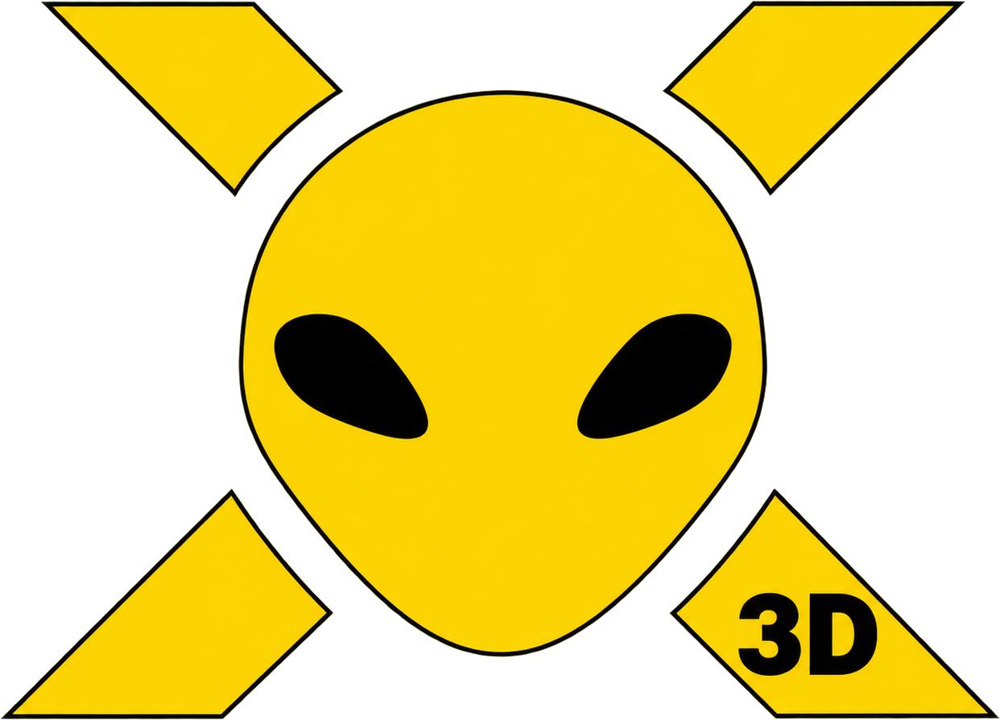
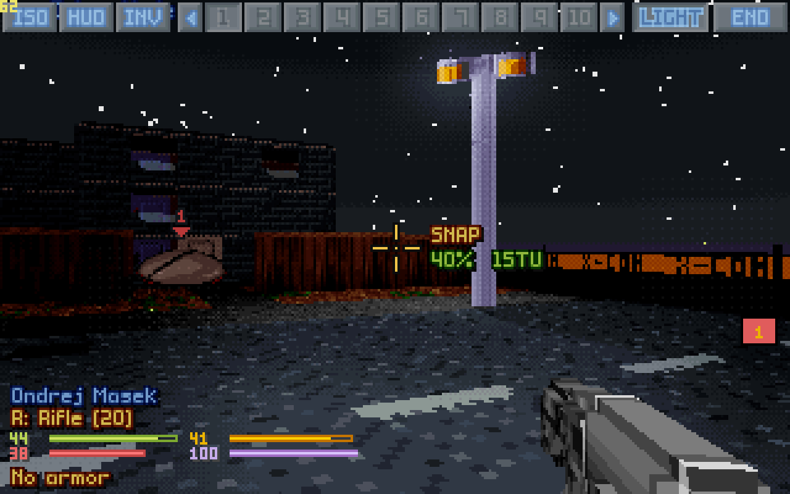
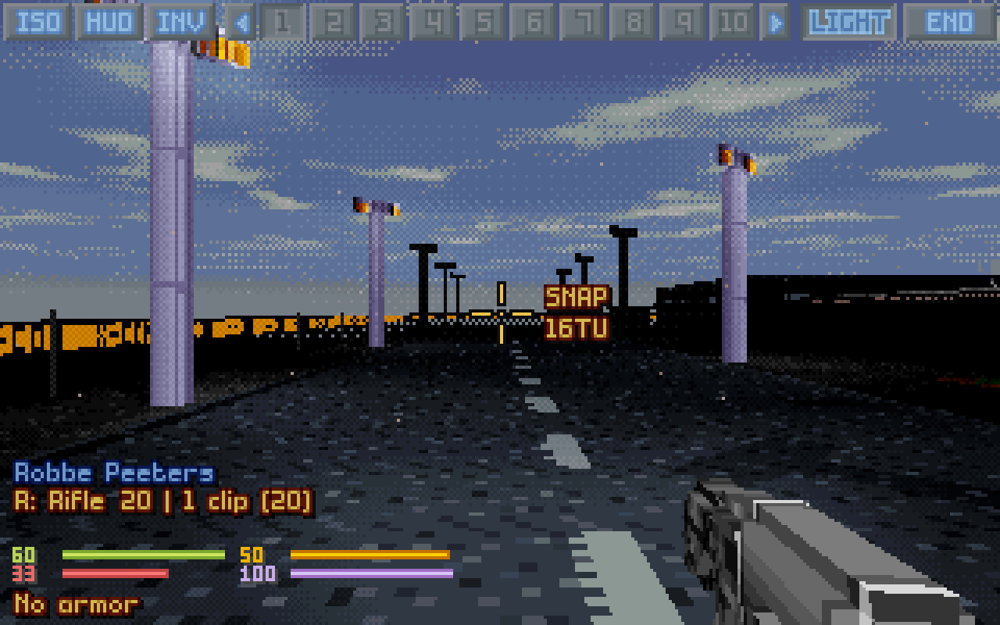
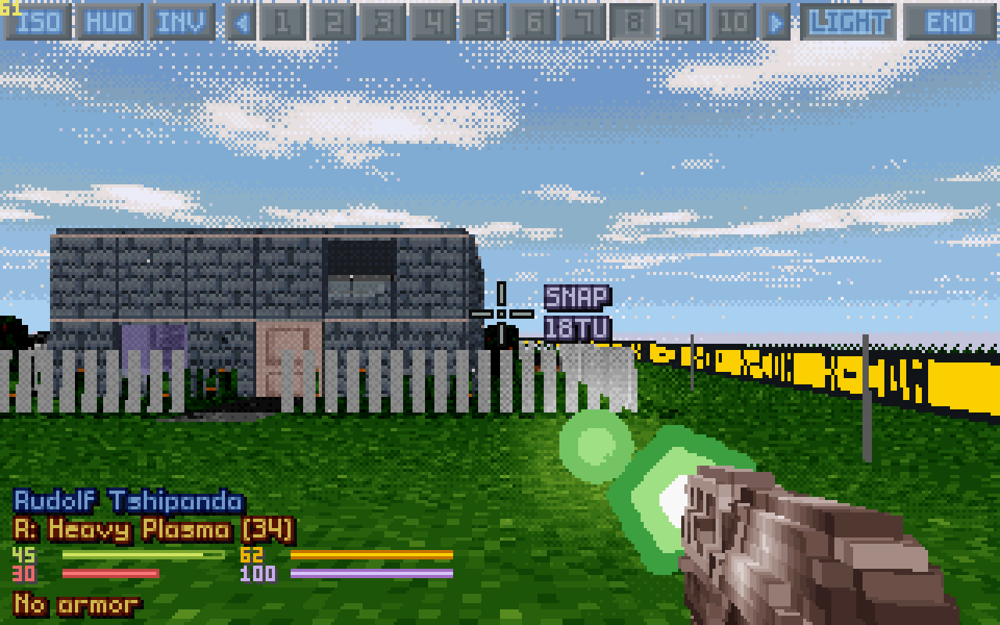
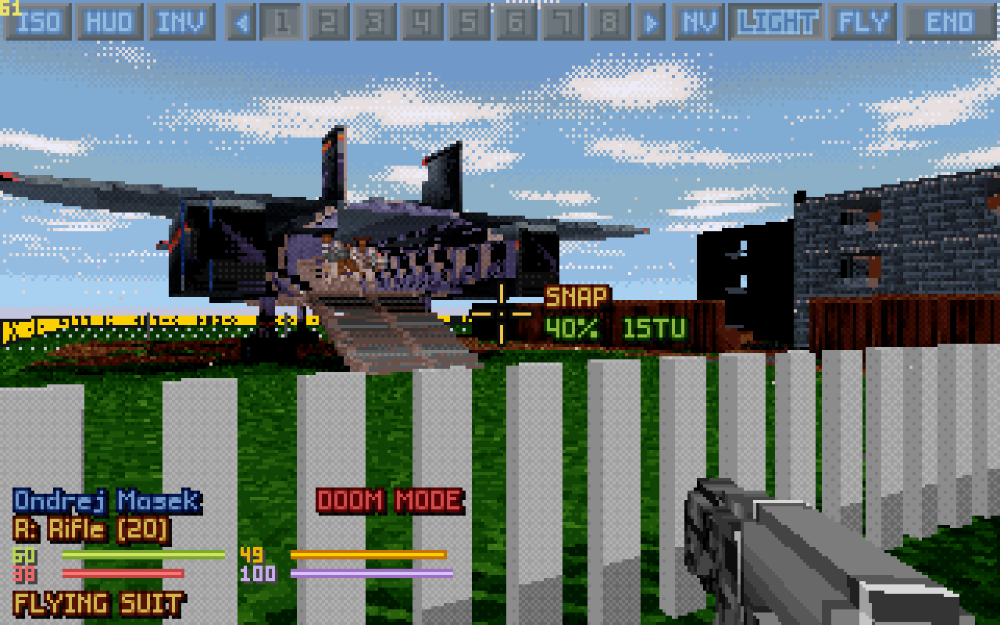
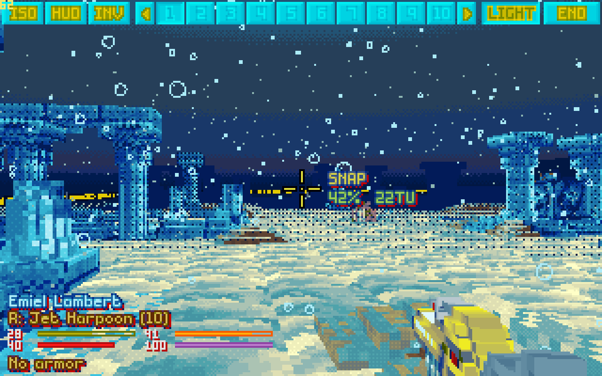
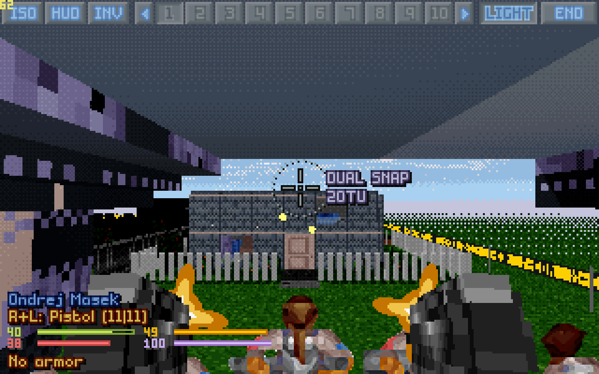
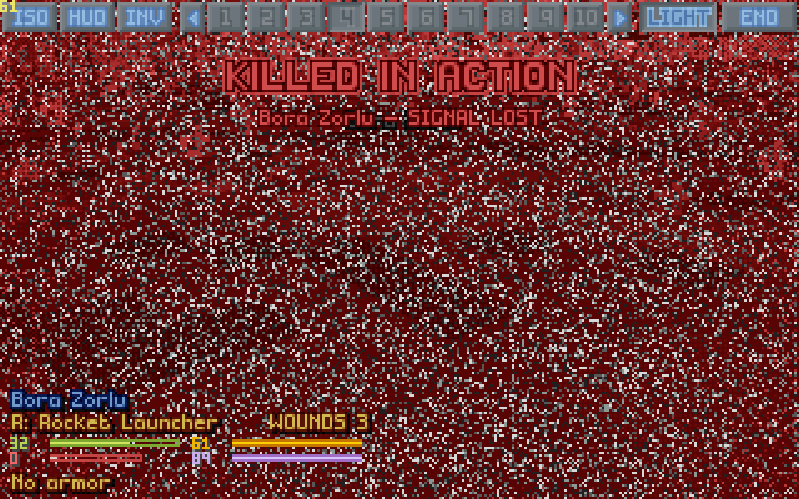
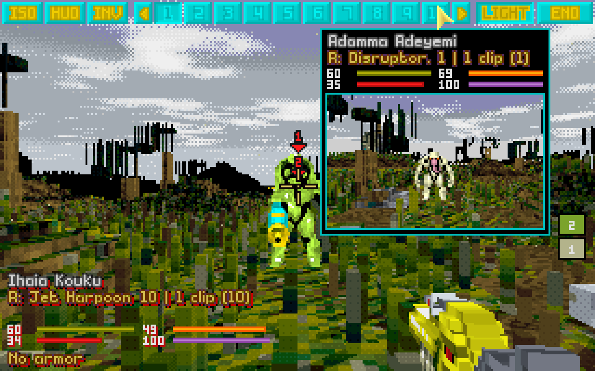
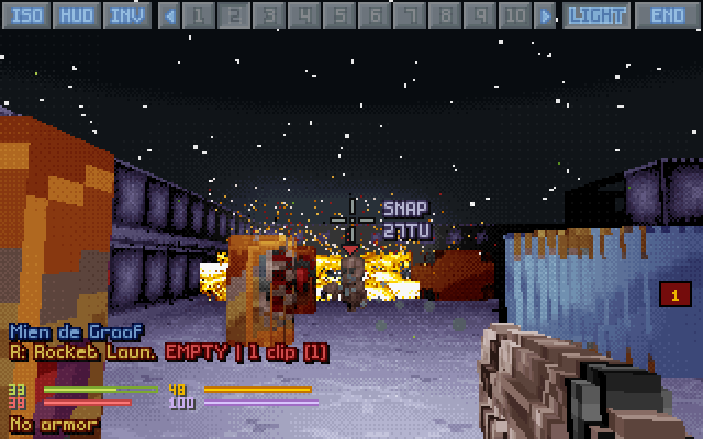

# OpenXcom3D

*A humble attempt at a wish from young days: to stand on the battlescape of* UFO: Enemy Unknown *and look around through a soldier's eyes.*

*UFO: Enemy Unknown* (X-COM: UFO Defense, 1994) is perhaps the greatest game of all time. OpenXcom3D adds a first-person 3D battlescape to **OpenXcom Extended**: you can switch between the isometric map and your soldier's view at any moment, and walk, fight and die in it. This is version **1.12**, for Linux, Windows and the Steam Deck, with a first, untested build for macOS. See [New in 1.12](#new-in-112).

**Both games are supported,** *UFO: Enemy Unknown* and *X-COM: Terror From The Deep*, and the big mods built on OXCE run in it too (XPiratez is played and tested here).

> **▶ [How to play it](https://b0realis.github.io/OpenXcom3D/play.html)**: the ready builds on Linux, Windows, the Steam Deck and macOS, step by step, and where your UFO and TFTD data goes; then [every key](https://b0realis.github.io/OpenXcom3D/play.html#keys), [every setting](https://b0realis.github.io/OpenXcom3D/play.html#settings) and what it means for how you play, what's on the screen, and every feature in pictures.
>
> **⚙ [How to build it](https://b0realis.github.io/OpenXcom3D/)**: compile it from source on Linux, on Windows, or for Windows on Linux.
>
> Downloads: the [latest release](https://github.com/b0realis/OpenXcom3D/releases/latest). Every key and setting: the [manual](OpenXcom3D_manual.md).

## What you can do

- **Switch at any moment:** **F8** takes you from the isometric map into the selected soldier's eyes and back, in the middle of a turn. Whatever you do in 3D is the game's own action, by its own rules: time units, energy, accuracy, reaction fire, line of sight, doors, morale.
- **Move:** walk and step sideways with **W A S D** in real time, each tile paid as you cross into it, or a tile at a time; sprint, jump, vault a fence, drop off a ledge, climb ladders and ride grav lifts, fly with flying armor, open doors (a little green door by the crosshair says it's on one), and lean round a corner.
- **Fight:** fire at the crosshair in every mode the weapon has (snap, aimed, auto, throw, launch, melee, psi), with the game's accuracy and line of fire, the path shown before you fire; or FPS style, each round where the crosshair points. Zoom in, fire two guns at once or one after the other, watch a shotgun's pellets fly, and in a tank turn the turret alone.
- **See:** the original maps, sprites, palette and sounds, rebuilt in 3D from the game's own voxel data: light and shadow, a flashlight and flares, night vision gear, smoke as the map draws it, rain and snow under a grey sky, windows that shatter, swinging doors, glowing UFOs, bullet holes and scorch marks, out to 200 tiles; the stars over XPiratez's space stations; under the sea, bubbles, marine snow and caustics.
- **Lead the squad:** every soldier's live helmet camera on the top bar (hover for their card, right click for the big soldier cam), a camera window over the isometric map, and the aliens' turn watched through the eyes of whoever sees the alien.
- **Feel it:** recoil and muzzle flashes, marks on the crosshair (white ticks for a hit, red for a kill, a blue shield when a strike does no harm), each hit's damage rising over the unit, shots whizzing past, rain, wind and fires heard round you, blood on the view and a heartbeat when badly hurt, panic and berserk through your soldier's own eyes, and a helmet camera dying in static.
- **Make it yours:** 100 settings and 39 keys of its own (**Options → 3D VIEW**), and a controller layout made for the Steam Deck.

| | |
|---|---|
|  |  |
|  |  |
|  |  |
|  |  |

## The goal

The research and testing goal of this project was to bring the battlescape into 3D while staying **faithful to the original game**: seamless, so that it feels as if it had been introduced the day *UFO: Enemy Unknown* was released. It uses **only the original assets** — the game's own maps, voxel shapes, sprites, palette and sounds (the few new sounds, such as the hit marker's tick, are made in code) — and no modern art spins that would split the game in two. Every action still goes through the original rules: time units, energy, accuracy, reaction fire, line of sight, doors, morale. The few deliberate additions (jumping over low obstacles, free flight between levels, night vision as gear, falling off ledges, FPS-style shooting, dual wield) are settings. A real-time mode will be attempted in the future, as a setting too.

The art, honestly, does not lend itself to full 3D: soldiers and aliens are 32×40 pixel sprites, terrain is 16×16×24 voxels, and there are 256 colours. Good ideas for that are welcome (a few are listed in the manual, under [Known limits and ideas](OpenXcom3D_manual.md#9-known-limits-and-ideas)). Nevertheless the gameplay turned out to be quite engaging and deep: a dark UFO corridor, a door that slides open, a shape you can't make out yet, and your squad's time units ticking away.

**But be careful!** It can be a traumatic experience.

## In the source after 1.12 (no download yet)

- **A GPU renderer** (setting *Renderer*: GPU; proved on Linux, new on Windows and macOS): the graphics card casts the 3D world's rays, the same walk and the same shading as the CPU's, checked pixel for pixel against it. The CPU renderer stays the default, and takes over by itself wherever the card can't.
- **3D resolution:** the 3D world as fine as its HUD, as the battlescape, or as the display itself, whatever the battlescape's scale: a full 1920×1080 view at 60 frames a second and more on a graphics card.
- **HUD scale:** the 3D HUD's magnification on big screens is yours to choose (Auto, x1 to x4); with 3D resolution at Display it has the display's pixels to itself, whatever the battlescape's scale.

## New in 1.12

- **Further, and the unseen in mist:** *View distance* reaches 60 to 200 tiles; *Unseen terrain* draws what your squad hasn't seen as slate shapes in a mist (or 0.9's fog, or as it is); with *Fog of war in 3D* off, the default, the floor below the stairs shows as you look at it.
- **Walls in the paint of their side:** a wall's face the map never shows takes the paint of the side it faces, a house's outside from behind (*Wall paint*).
- **Enemy markers in the buttons' colours:** red seen, green seen only by the squad, yellow hidden but in a clear line of fire.
- **Wounded markers:** our own wounded in the map buttons' blue, those about to pass out in purple.
- **Damage numbers:** a hit's damage rises over the unit, in 3D and on the map: health red, armour blue, stun purple, a grey 0 when the armour stopped it.
- **Ambient sounds:** rain and wind, muffled under a roof, and fires crackling near you.
- **Camera artifacts:** the helmet cameras' static and glitches as they are, lighter (no glitch over 0.15 s) or gone; a fallen soldier's camera keeps its static.
- **Hit as drawn:** with *Full sprite hitboxes* a unit is hit exactly where its picture shows, between two tiles while it walks or flies, by arrows and other arcing shots too (a big unit aimed at its middle); *Hitboxes* outlines what the shots test.
- **Fixed:** a sprint walks on past enemies coming into sight, and any walk stops when the soldier is shot at, as on the map; a laser up close starts at the gun, with its flash and kick; a guided missile takes only its launcher's waypoints in 3D; a built-in weapon counts as one when both hands are full; a unit straight below or above no longer spins as you shoot it; a sidestep short of time units no longer jitters; downed unit icons only for the body under the crosshair; no red marker over your own wounded; *Pixel size* goes round; seven setting values renamed to fit their column (Each side, All rooms, Clear shot, As map, Percent, Smooth+).

## New in 1.11

- **Skies by the weather and the place:** rain and snow fall from a grey deck of cloud, with no sun, moon or stars and no sun shadows. Space and orbit are black and starry, the Earth below XPiratez's stations; the Moon has the Earth's disc in its sky; Mars is butterscotch by day and dark by night; XPiratez's Shadowlands lie in a violet void. The big mods' seas run on past the map's edge as TFTD's does, and 19 more underground maps (metros, sewers, crypts, lairs) lie under rock.
- **Reload from anywhere:** **R** in 3D loads a clip that fits from anywhere the soldier carries one, and says why when nothing loads: already loaded, no clip that fits, or the time units it needs (the big mods charge a clip's move to the hand).
- **A door under the crosshair:** a little green door left of the crosshair when it's on a door you have seen.
- **Flight kept:** a soldier's flight switch (**B**) stays as it was through a save and a load.
- **Enemy buttons at the right:** in 3D the buttons for the enemies in sight stand in a column at the right, centred on the screen's height on any screen, clear of the red arrows at the edge.
- **Smoke as the map draws it**, as in 0.8: no grey wall where your soldier's sight runs out, nothing stacked; Modern's soft clouds never more opaque than *Smoke opacity*, now a maximum (80% by day, 45% at night by default, up to 95%), Original's dots as on the map. And cheaper.
- **Enemies by your soldier's own eyes:** an enemy only squadmates see isn't drawn through smoke, only its marker.
- **A tank's turret switch:** **TURRET** on the top bar turns the turret alone, at the turret's cost; off, the whole tank turns as before.
- **Live motion scanner**, a setting (off, on with the FPS playstyle): off, the scanner is one look from where it's used, as in the game.
- **Finer sprites up close:** *Sprite upscaling*'s new top choice, **Finest** (the default), draws units, items and effects six times finer, with softer shading and small eyes and highlights kept; *Smooth* and *Smooth + detail* are cleaner too.
- **Chain explosions as one blast:** with *Instant chain explosions* on, a chain of explosives resolves at once, shown as a fireball at each explosive in quick succession with a single explosion sound; the damage is the game's own, and an explosion that sets nothing off is unchanged.
- **A melee blow's hit chance** by the crosshair, as a shot's (**MELEE 23% 4TU**).
- **Fixed:** T'leth's first stage and the artifact site's second have their own dark green rock overhead, not black; the game's Bug Hunt and debug line sits under the top bar, not over its buttons; flying with *Falling* off goes sideways through the air again; touching down keeps flight on (Page Down on the ground switches it off); Ctrl+End's debug light lights the 3D view as it lights the map; a melee blow strikes a body lying on a diagonal tile too.
- **The logo** in every download: its picture, a sharper icon (256 pixels), and on Windows an icon for a shortcut.

## Earlier versions

- **1.10:** window glass that shatters, a blue shield for no harm, hits on downed units, arcs at the open sky, flare shadows, futuristic night vision, cameras that see as the eyes, *Screen shake* and *Recoil*, akimbo at 20%, and the fire modes from quantity to quality.
- **1.09:** a UFO's light inside it even, smoke opacity by day and at night, melee by the crosshair and at floors, the motion scanner in 3D, full sprite hitboxes, quick deaths, *Playstyle*, Doom IDCLIP, instant chain explosions, and a logo of its own.
- **1.08:** every pellet of a shotgun lands on its own, akimbo on the isometric map, the sea in waves, rooms in their own light; aiming at the fringes, an accuracy line under the crosshair, stat bars that read, a check before an unsafe landing, XPiratez's sludge with a surface and catwalks that show, and the play guide with every key and setting.
- **1.07:** akimbo's two guns take turns round by round, each its whole burst, both lasers; UFO's shop racks in their shape, the sea on TFTD's islands, see-through glass doors; units above no longer through the ceiling; mods' own mode names on the crosshair; no more shotgun lag on the map.
- **1.06:** everything by the crosshair (melee, medi-kits, every cost of an action), spray bursts from 3D, flying with the view, heat vision thinning the smoke, Cydonia's lift cages, *Ghost opacity*, the rank before the name.
- **1.05:** a crash ending a long battle fixed, helmet cameras that feel live (static in spells), the top bar across a wide screen, akimbo in turn, shotgun pellets on the map, arcing shots at the exact point.
- **1.04:** a long play report: doors you open by looking at them, bullet holes on everything, the map camera, aiming that tells the truth (no "No line of fire" with the shot on the unit), underground maps in rock, akimbo reworked, unit facing on **Left Alt**, shotgun pellets in flight, falls and lifts at the walking pace, a purple haze through a mind-controlled alien's eyes, and a first macOS build.
- **1.03:** a first Windows build; the aliens' turn on the map; sprint and en passant; ladders and lifts; helmet cameras with a bad signal; priming in one click; looking straight up and down; the XPiratez weapons.
- **1.02:** gunplay gone over gun by gun: every weapon its own round, tracer, muzzle flash and kick; rocket trails; Original and Modern smoke.
- **1.01:** the flashlight on its own key, the soldier cam, every key and setting gone over once more.
- **1.0:** smoke you can see through, melee weapons swung, zoom, the path of a throw, the aliens' turn watched, a tactical flashlight, and 20–32% faster.
- **0.9:** the first play-test round: ledges, diagonal gaps, lean, the classic HUD in 3D, and more on the Steam Deck's buttons.

Every version, in full: the manual's [version history](OpenXcom3D_manual.md#11-version-history).

## Getting it

You need your own copy of the original game data (*UFO: Enemy Unknown / X-COM: UFO Defense* and/or *X-COM: Terror From The Deep*, from Steam, GOG or the old CDs). Nothing of it is included here. The **[play guide](https://b0realis.github.io/OpenXcom3D/play.html)** has every step for your system; in short:

- **Linux (x86-64):** from the [latest release](https://github.com/b0realis/OpenXcom3D/releases/latest) take the **AppImage** (one file: make it executable and run it) or the **archive** (unpack it anywhere and run `./play.sh`). Nothing needs installing; it runs on any Linux from 2021 on (glibc 2.34: Ubuntu 22.04 and newer, Debian 12, Fedora, Arch, SteamOS).
- **Windows 10 and 11 (64-bit):** take the **zip**, unpack it into a folder of yours (not *Program Files*) and double-click `play.bat`. It's not signed, so Windows may warn the first time: *More info*, then *Run anyway*.
- **Steam Deck:** the Linux archive, set up once in Desktop Mode and added to Steam, played in Game Mode with its own controller layout.
- **macOS (Apple silicon and Intel, macOS 11 and newer):** the **macOS zip** from the latest release: unpack it and open **OpenXcom3D.app**. A first build, made by the [automatic builds](https://github.com/b0realis/OpenXcom3D/actions/workflows/build.yml?query=branch%3Amain) and not yet tried on a real Mac.
- **From source:** `python3 install.py --from-source` clones OXCE at the commit below, applies the patch, builds and installs; the **[build guide](https://b0realis.github.io/OpenXcom3D/)** has every step by hand, for Linux and for Windows.

The first time, it finds *X-COM: UFO Defense* and *Terror From The Deep* in your Steam libraries by itself; otherwise put the game's folder next to it, named `UFO` (or `TFTD`). Its data is only linked, never copied or changed. Then start a game (or a **New Battle**) and press **F8** in battle: mouse to look, **W A S D** to walk, the left button to fire, **F8** back to the map.

## Help wanted

If someone in the ingenious OpenXcom community has the will to improve this further, help is very welcome: ideas for the art, translations, play-testing, and making the code better. Issues and pull requests are open.

**Mac players** especially, and **reports from Windows:** GitHub's machines build a macOS version on every change, but none of us has a Mac, so it has only been started there, never played. The Windows zip is made on Linux (with llvm-mingw) and played under Wine; GitHub's Windows checks that it starts and finds the games in Steam, but nobody has played a battle on a real Windows machine yet. Trying either and saying how it went would help a lot.

## What it is based on

OpenXcom3D stems from **OpenXcom Extended** at exactly this commit:

| | |
|---|---|
| Repository | **https://github.com/MeridianOXC/OpenXcom** |
| Branch | **`oxce-plus`** |
| Commit | **`f0134ef8065799c7723953d64b565f7832bfd782`** (2026-09-29 15:04:49 +0200, Meridian: "Merge remote-tracking branch 'SupSuper/master' into oxce-plus") |
| Version | **OpenXcom Extended 8.7.1 (v2026-09-19)** |

All changes on top of it are in one file, [`openxcom3d.patch`](openxcom3d.patch) (it applies with `git apply` to a clean checkout of that commit):

- [`src/FirstPerson/`](src/FirstPerson): the 3D view, an engine add-on (renderer, controller, sounds, options), one file per topic and commented throughout;
- hooks in the core (48 files, about 1,900 lines, half of them the shot's own in `ProjectileFlyBState`): see the patch;
- [`mod/OpenXcom3D/`](mod/OpenXcom3D): the data mod that switches it on.

`src/` and `mod/` in this repository are the same files as in the patch, for reading. Built with `-DOXCE_FIRSTPERSON=OFF`, it is plain OXCE again.

## Thanks

To the open-source community and the GNU project, whose tools and licence make work like this possible, and to the **OpenXcom** and **OpenXcom Extended** developers — SupSuper, Meridian and everyone who contributed — for doing an amazing job keeping this game alive. OpenXcom3D is only a small addition on top of their work.

To **John Carmack** and **id Software**, for spearheading 3D games. Wolfenstein 3D, Doom and Quake showed the world what a ray cast through a grid and a fast loop could do, and every first-person game since stands on their shoulders, this one included: its 3D view is a ray caster at heart. The cheats in the 3D view, **Doom mode**, **IDKFA** and **IDDQD**, are a small tribute to you. Thank you, guys!

The original games and their data belong to their owners. OpenXcom, OpenXcom Extended and OpenXcom3D are free software under the [GNU GPL v3](LICENSE).

I wish you all health, and enjoy playing.

*OpenXcom3D team: b0realis, mumble*
