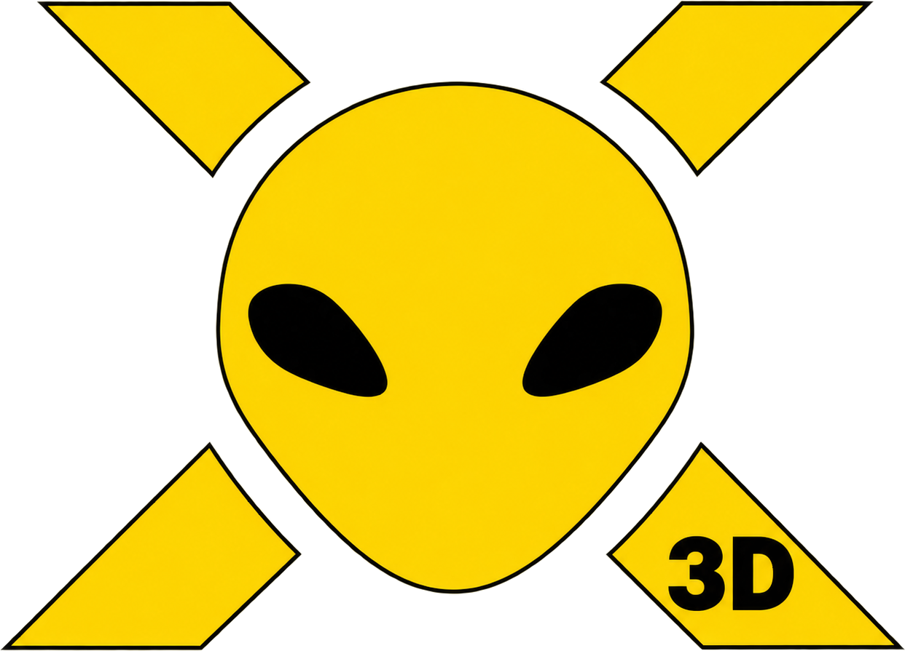
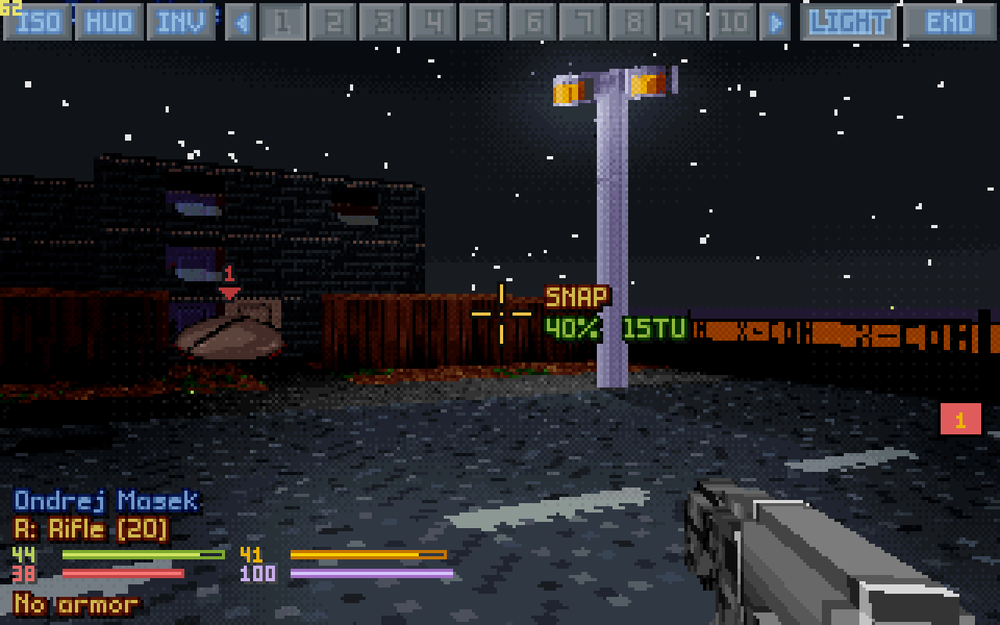
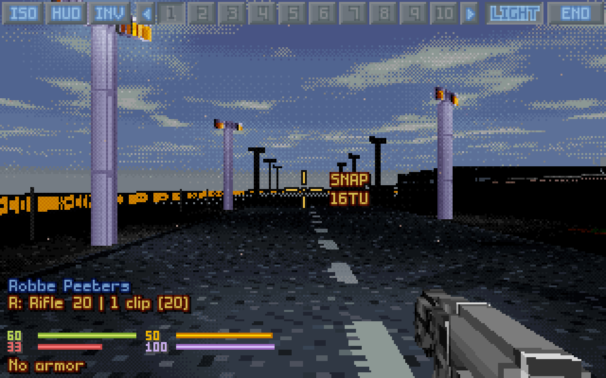
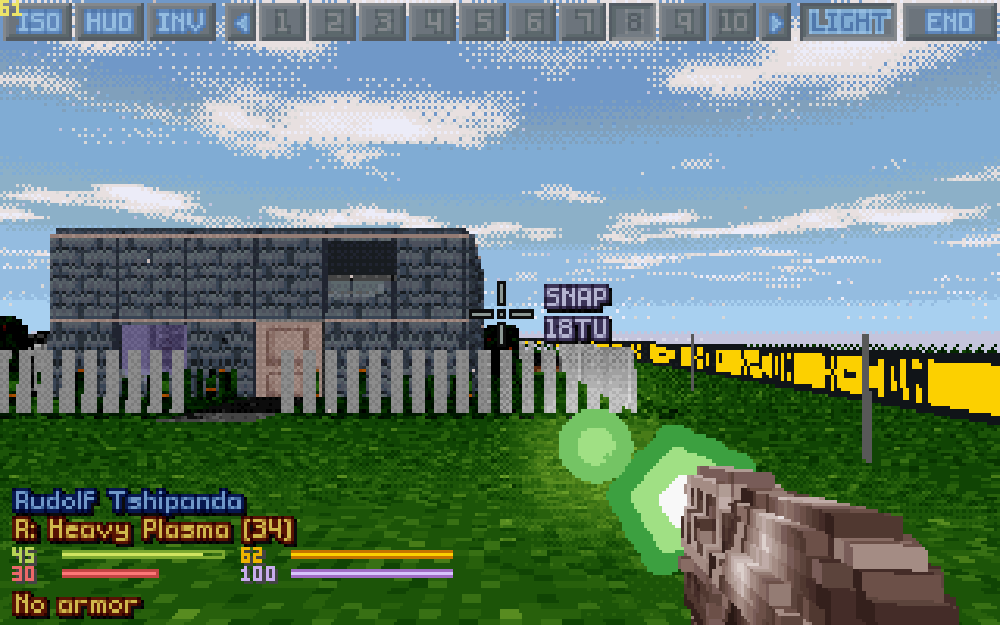
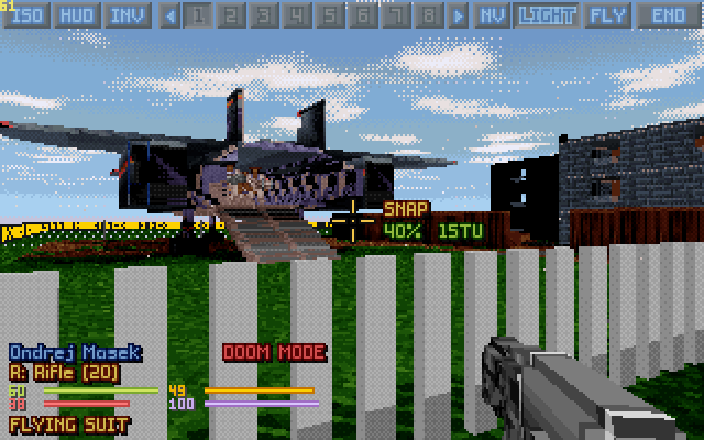
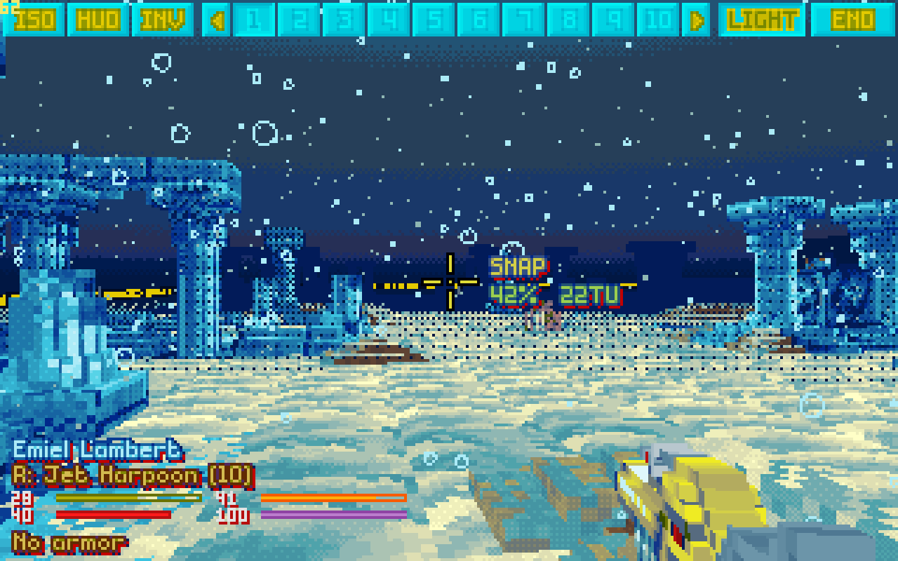
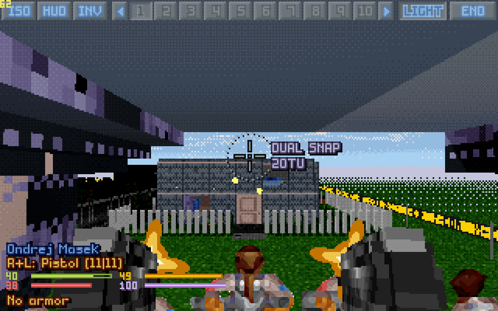
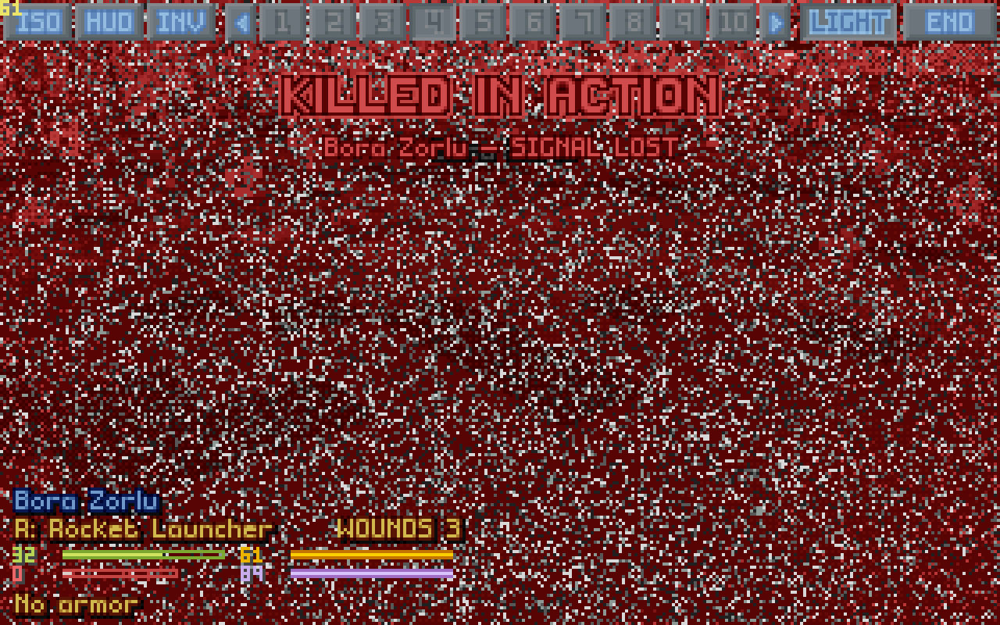
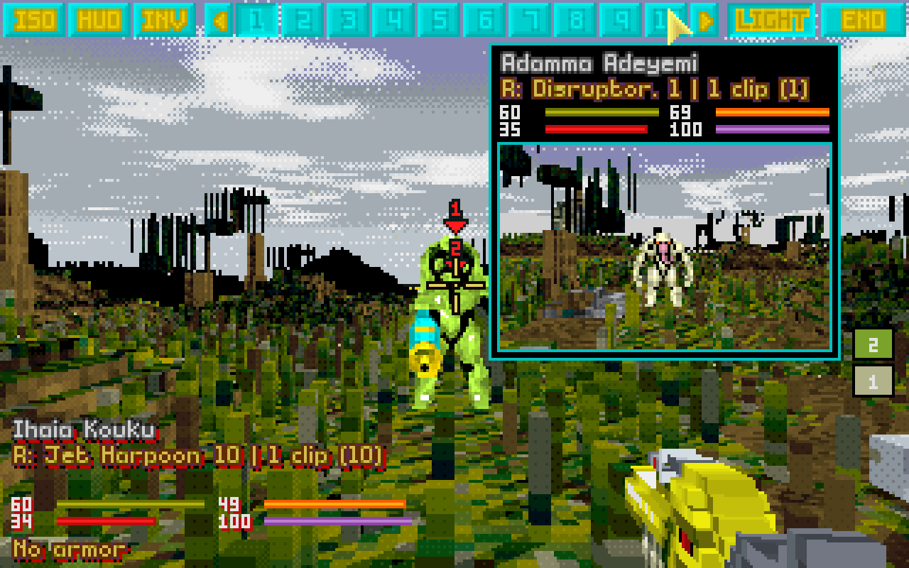
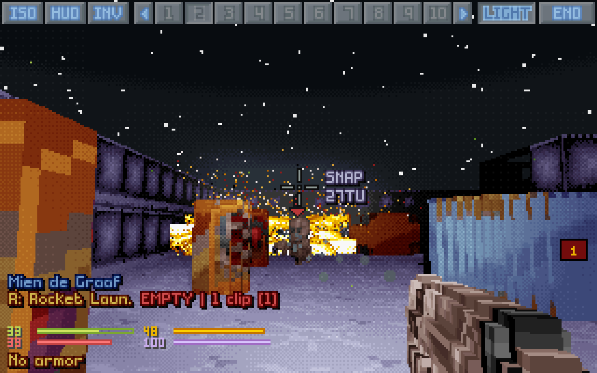

# OpenXcom3D

*A humble attempt at a wish from young days: to stand on the battlescape of* UFO: Enemy Unknown *and look around through a soldier's eyes.*

*UFO: Enemy Unknown* (X-COM: UFO Defense, 1994) is perhaps the greatest game of all time. OpenXcom3D adds a first-person 3D battlescape to **OpenXcom Extended**: you can switch between the isometric map and your soldier's view at any moment, and walk, fight and die in it. This is version **1.08**, for Linux, Windows and the Steam Deck, with a first, untested build for macOS.

**Both games are supported,** *UFO: Enemy Unknown* and *X-COM: Terror From The Deep*, and the big mods built on OXCE run in it too (XPiratez is played and tested here).

> **▶ [How to play it](https://b0realis.github.io/OpenXcom3D/play.html)**: the ready builds on Linux, Windows, the Steam Deck and macOS, step by step, and where your UFO and TFTD data goes; then [every key](https://b0realis.github.io/OpenXcom3D/play.html#keys), [every setting](https://b0realis.github.io/OpenXcom3D/play.html#settings) and what it means for how you play, what's on the screen, and every feature in pictures.
>
> **⚙ [How to build it](https://b0realis.github.io/OpenXcom3D/)**: compile it from source on Linux, on Windows, or for Windows on Linux.
>
> Downloads: the [latest release](https://github.com/b0realis/OpenXcom3D/releases/latest). Every key and setting: the [manual](OpenXcom3D_manual.md).

## What you can do

- **Switch at any moment:** **F8** takes you from the isometric map into the selected soldier's eyes and back, in the middle of a turn. Whatever you do in 3D is the game's own action, by its own rules: time units, energy, accuracy, reaction fire, line of sight, doors, morale.
- **Move:** walk and step sideways with **W A S D** in real time, each tile paid as you cross into it, or a tile at a time; sprint, jump, vault a fence, drop off a ledge, climb ladders and ride grav lifts, fly with flying armor, open doors, and lean round a corner.
- **Fight:** fire at the crosshair in every mode the weapon has (snap, aimed, auto, throw, launch, melee, psi), with the game's accuracy and line of fire, the path shown before you fire; or FPS style, each round where the crosshair points. Zoom in, fire two guns at once or one after the other, and watch a shotgun's pellets fly.
- **See:** the original maps, sprites, palette and sounds, rebuilt in 3D from the game's own voxel data: light and shadow, a flashlight and flares, night vision gear, smoke you can see through, rain and snow, swinging doors, glowing UFOs, bullet holes and scorch marks; under the sea, bubbles, marine snow and caustics.
- **Lead the squad:** every soldier's live helmet camera on the top bar (hover for their card, right click for the big soldier cam), a camera window over the isometric map, and the aliens' turn watched through the eyes of whoever sees the alien.
- **Feel it:** recoil and muzzle flashes, hit markers, shots whizzing past, blood on the view and a heartbeat when badly hurt, panic and berserk through your soldier's own eyes, and a helmet camera dying in static.
- **Make it yours:** 69 settings and 33 keys of its own (**Options → 3D VIEW**), and a controller layout made for the Steam Deck.

| | |
|---|---|
|  |  |
|  |  |
|  |  |
|  |  |

## The goal

The research and testing goal of this project was to bring the battlescape into 3D while staying **faithful to the original game**: seamless, so that it feels as if it had been introduced the day *UFO: Enemy Unknown* was released. It uses **only the original assets** — the game's own maps, voxel shapes, sprites, palette and sounds (the few new sounds, such as the hit marker's tick, are made in code) — and no modern art spins that would split the game in two. Every action still goes through the original rules: time units, energy, accuracy, reaction fire, line of sight, doors, morale. The few deliberate additions (jumping over low obstacles, free flight between levels, night vision as gear, falling off ledges, FPS-style shooting, dual wield) are settings. A real-time mode will be attempted in the future, as a setting too.

The art, honestly, does not lend itself to full 3D: soldiers and aliens are 32×40 pixel sprites, terrain is 16×16×24 voxels, and there are 256 colours. Good ideas for that are welcome (a few are listed in the manual, under [Known limits and ideas](OpenXcom3D_manual.md#9-known-limits-and-ideas)). Nevertheless the gameplay turned out to be quite engaging and deep: a dark UFO corridor, a door that slides open, a shape you can't make out yet, and your squad's time units ticking away.

**But be careful!** It can be a traumatic experience.

## New in 1.09

- **A UFO's light inside it, even:** inside a UFO its light no longer lays a grid of dots over the view; the walls and floors take its colour evenly and stay sharp, strong colours (a red lift pad) keep theirs, and the aura's motes stay outside.
- **Smoke opacity, by day and at night:** two settings for the smoke you see through, 45% by day (as before) and 25% at night and in the dark, where lit smoke could be blinding; where your soldier can't see through, it stays solid.
- **No walking on out of the map through a door:** one slow frame in a doorway could send the view walking on for ever while the soldier stood in the next tile; now the step always ends inside it.
- **Shots nearer the crosshair:** when no line reaches the very point under the crosshair (along a bumpy floor, over a counter), the shot goes for the nearest point that one does, not the tile's middle; and aiming at your own tile no longer turns your soldier south (an OXCE quirk, fixed on the map too).
- **Melee by the crosshair:** a blow strikes the unit you aim at beside you (turning to them, paid with *Turning costs TU*), or the wall you aim at, not whatever stands the way the compass says you face.
- **Melee at floors and straight up:** with terrain melee on, a blow at the floor or ceiling you aim at strikes it (setting *Melee hits floors*); a unit straight above or below you is struck when nothing solid lies between.
- **The snap shot in FPS style:** Z fires the gun's single snap shot again (it fired a burst, as a click on AUTO does).
- **Names by the hitbox:** the unit you point at (its name, the middle click, a medi-kit's patient, a melee blow) is found by the game's hitbox first, so small moving aliens no longer make the name blink.
- **Tails on the floor:** what a unit's art draws below its feet (a snake's tail, a long body) lies flat on the floor instead of sinking into it.
- **See-through corpses** (a setting, off at first): a corpse or item under the crosshair turns faint while you aim past it, as the game's shots pass through it.
- **Page Up flies:** off a lift, Page Up switches flight on and flies up in one press; Page Down on the ground switches it off.
- **Settings for new players:** new installs start with the game's own mechanics (tile moves, flight at the game's cost, no vaulting, night vision for all), hitboxes for the unit you aim at; *FPS-style shooting (easier)* says what it does; one *Akimbo* setting; the settings list in sections.
- **Bullet holes under the zoom:** zoomed in, holes and scorches grow with everything round them (they looked smaller).
- **A clean view:** P's second press hides the crosshair and its info too; a third brings it all back.
- **A logo of its own:** the alien in the yellow X, now the icon of the AppImage, the Windows game, the Mac app, the game's window, the menu entry and the web pages.

## Earlier versions

- **1.08:** every pellet of a shotgun lands on its own, akimbo on the isometric map, the sea in waves, rooms in their own light; aiming at the fringes, an accuracy line under the crosshair, stat bars that read, a check before an unsafe landing, XPiratez's sludge with a surface and catwalks that show, and the play guide with every key and setting.
- **1.07:** akimbo's two guns take turns round by round, each its whole burst, both lasers; UFO's shop racks in their shape, the sea on TFTD's islands, see-through glass doors; units above no longer through the ceiling; mods' own mode names on the crosshair; no more shotgun lag on the map.
- **1.06:** everything by the crosshair (melee, medi-kits, every cost of an action), spray bursts from 3D, flying with the view, heat vision thinning the smoke, Cydonia's lift cages, *Ghost opacity*, the rank before the name.
- **1.05:** a crash ending a long battle fixed, helmet cameras that feel live (static in spells), the top bar across a wide screen, akimbo in turn, shotgun pellets on the map, arcing shots at the exact point.
- **1.04:** a long play report: doors you open by looking at them, bullet holes on everything, the map camera, aiming that tells the truth (no "No line of fire" with the shot on the unit), underground maps in rock, akimbo reworked, unit facing on **Left Alt**, shotgun pellets in flight, falls and lifts at the walking pace, a purple haze through a mind-controlled alien's eyes, and a first macOS build.
- **1.03:** a first Windows build; the aliens' turn on the map; sprint and en passant; ladders and lifts; helmet cameras with a bad signal; priming in one click; looking straight up and down; the XPiratez weapons.
- **1.02:** gunplay gone over gun by gun: every weapon its own round, tracer, muzzle flash and kick; rocket trails; Original and Modern smoke.
- **1.01:** the flashlight on its own key, the soldier cam, every key and setting gone over once more.
- **1.0:** smoke you can see through, melee weapons swung, zoom, the path of a throw, the aliens' turn watched, a tactical flashlight, and 20–32% faster.
- **0.9:** the first play-test round: ledges, diagonal gaps, lean, the classic HUD in 3D, and more on the Steam Deck's buttons.

Every version, in full: the manual's [version history](OpenXcom3D_manual.md#11-version-history).

## Getting it

You need your own copy of the original game data (*UFO: Enemy Unknown / X-COM: UFO Defense* and/or *X-COM: Terror From The Deep*, from Steam, GOG or the old CDs). Nothing of it is included here. The **[play guide](https://b0realis.github.io/OpenXcom3D/play.html)** has every step for your system; in short:

- **Linux (x86-64):** from the [latest release](https://github.com/b0realis/OpenXcom3D/releases/latest) take the **AppImage** (one file: make it executable and run it) or the **archive** (unpack it anywhere and run `./play.sh`). Nothing needs installing; it runs on any Linux from 2021 on (glibc 2.34: Ubuntu 22.04 and newer, Debian 12, Fedora, Arch, SteamOS).
- **Windows 10 and 11 (64-bit):** take the **zip**, unpack it into a folder of yours (not *Program Files*) and double-click `play.bat`. It's not signed, so Windows may warn the first time: *More info*, then *Run anyway*.
- **Steam Deck:** the Linux archive, set up once in Desktop Mode and added to Steam, played in Game Mode with its own controller layout.
- **macOS (Apple silicon and Intel, macOS 11 and newer):** a first, untested build, made by the [automatic builds](https://github.com/b0realis/OpenXcom3D/actions/workflows/build.yml?query=branch%3Amain) (under *Artifacts*, **macos-release**).
- **From source:** `python3 install.py --from-source` clones OXCE at the commit below, applies the patch, builds and installs; the **[build guide](https://b0realis.github.io/OpenXcom3D/)** has every step by hand, for Linux and for Windows.

The first time, it finds *X-COM: UFO Defense* and *Terror From The Deep* in your Steam libraries by itself; otherwise put the game's folder next to it, named `UFO` (or `TFTD`). Its data is only linked, never copied or changed. Then start a game (or a **New Battle**) and press **F8** in battle: mouse to look, **W A S D** to walk, the left button to fire, **F8** back to the map.

## Help wanted

If someone in the ingenious OpenXcom community has the will to improve this further, help is very welcome: ideas for the art, translations, play-testing, and making the code better. Issues and pull requests are open.

**Mac players** especially, and **reports from Windows:** GitHub's machines build a macOS version on every change, but none of us has a Mac, so it has only been started there, never played. The Windows zip is made on Linux (with llvm-mingw) and played under Wine; GitHub's Windows checks that it starts and finds the games in Steam, but nobody has played a battle on a real Windows machine yet. Trying either and saying how it went would help a lot.

## What it is based on

OpenXcom3D stems from **OpenXcom Extended** at exactly this commit:

| | |
|---|---|
| Repository | **https://github.com/MeridianOXC/OpenXcom** |
| Branch | **`oxce-plus`** |
| Commit | **`f0134ef8065799c7723953d64b565f7832bfd782`** (2026-09-29 15:04:49 +0200, Meridian: "Merge remote-tracking branch 'SupSuper/master' into oxce-plus") |
| Version | **OpenXcom Extended 8.7.1 (v2026-09-19)** |

All changes on top of it are in one file, [`openxcom3d.patch`](openxcom3d.patch) (it applies with `git apply` to a clean checkout of that commit):

- [`src/FirstPerson/`](src/FirstPerson): the 3D view, an engine add-on (renderer, controller, sounds, options), one file per topic and commented throughout;
- hooks in the core (41 files, about 1,500 lines, most of them the shot's own in `ProjectileFlyBState`): see the patch;
- [`mod/OpenXcom3D/`](mod/OpenXcom3D): the data mod that switches it on.

`src/` and `mod/` in this repository are the same files as in the patch, for reading. Built with `-DOXCE_FIRSTPERSON=OFF`, it is plain OXCE again.

## Thanks

To the open-source community and the GNU project, whose tools and licence make work like this possible, and to the **OpenXcom** and **OpenXcom Extended** developers — SupSuper, Meridian and everyone who contributed — for doing an amazing job keeping this game alive. OpenXcom3D is only a small addition on top of their work.

To **John Carmack** and **id Software**, for spearheading 3D games. Wolfenstein 3D, Doom and Quake showed the world what a ray cast through a grid and a fast loop could do, and every first-person game since stands on their shoulders, this one included: its 3D view is a ray caster at heart. The cheats in the 3D view, **Doom mode**, **IDKFA** and **IDDQD**, are a small tribute to you. Thank you, guys!

The original games and their data belong to their owners. OpenXcom, OpenXcom Extended and OpenXcom3D are free software under the [GNU GPL v3](LICENSE).

I wish you all health, and enjoy playing.

*OpenXcom3D team: b0realis, mumble*
