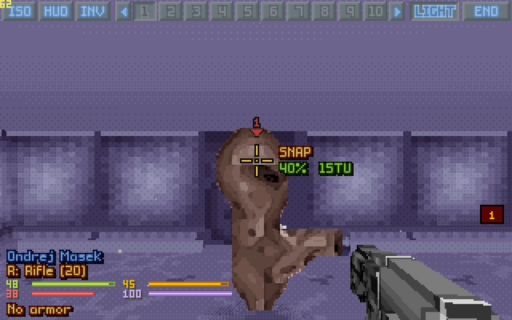

# OpenXcom3D

*A humble attempt at a wish from young days: to stand on the battlescape of* UFO: Enemy Unknown *and look around through a soldier's eyes.*

*UFO: Enemy Unknown* (X-COM: UFO Defense, 1994) is perhaps the greatest game of all time. OpenXcom3D adds a first-person 3D battlescape to **OpenXcom Extended**: you can switch between the isometric map and your soldier's view at any moment, and walk, fight and die in it. This is version **0.7**.

**Both games are supported:** *UFO: Enemy Unknown* and *X-COM: Terror From The Deep*.

## The goal

The research and testing goal of this project was to bring the battlescape into 3D while staying **faithful to the original game**: seamless, so that it feels as if it had been introduced the day *UFO: Enemy Unknown* was released. It uses **only the original assets** — the game's own maps, voxel shapes, sprites, palette and sounds — and no modern art spins that would split the game in two. Every action still goes through the original rules: time units, energy, accuracy, reaction fire, line of sight, doors, morale. The few deliberate additions (jumping over low obstacles, night vision as gear, falling off ledges, FPS-style shooting, dual wield) are settings.

The art, honestly, does not lend itself to full 3D: soldiers and aliens are 32×40 pixel sprites, terrain is 16×16×24 voxels, and there are 256 colours. Some good ideas for that are welcome (a few are listed in the manual, under [Known limits and ideas](OpenXcom3D_manual.md#9-known-limits-and-ideas)). Nevertheless the gameplay turned out to be quite engaging and deep: a dark UFO corridor, a door that slides open, a shape you can't make out yet, and your squad's time units ticking away.

**But be careful!** It can be a traumatic experience.

| | |
|---|---|
|  |  |
|  |  |
|  |  |

## Help wanted

If someone in the ingenious OpenXcom community has the will to improve this further, help is very welcome: ideas for the art, other platforms (only Linux is tested), translations, play-testing, and making the code better. Issues and pull requests are open.

## What it is based on

OpenXcom3D stems from **OpenXcom Extended** at exactly this commit:

| | |
|---|---|
| Repository | **https://github.com/MeridianOXC/OpenXcom** |
| Branch | **`oxce-plus`** |
| Commit | **`f0134ef8065799c7723953d64b565f7832bfd782`** (2026-09-29 15:04:49 +0200, Meridian: "Merge remote-tracking branch 'SupSuper/master' into oxce-plus") |
| Version | **OpenXcom Extended 8.7.1 (v2026-09-19)** |

All changes on top of it are in one file, [`openxcom3d.patch`](openxcom3d.patch) (it applies with `git apply` to a clean checkout of that commit):

- [`src/FirstPerson/`](src/FirstPerson): the 3D view, an engine add-on (renderer, controller, sounds, options);
- small hooks in the core (36 files, about 560 lines): see the patch;
- [`mod/OpenXcom3D/`](mod/OpenXcom3D): the data mod that switches it on.

`src/` and `mod/` in this repository are the same files as in the patch, for reading. Built with `-DOXCE_FIRSTPERSON=OFF`, it is plain OXCE again.

## Getting it

You need your own copy of the original game data (*UFO: Enemy Unknown / X-COM: UFO Defense* and/or *X-COM: Terror From The Deep*, e.g. from Steam or GOG). Nothing of it is included here.

- **Prebuilt (Linux x86-64):** download the archive from the [Releases](../../releases) page, unpack it and run `python3 install.py`: it finds your game data and links it (never copies or changes it).
- **From source:** `python3 install.py --from-source` clones OXCE at the commit above, applies the patch, builds and installs.

Start a game (or a **New Battle**) and in battle press **F8** to go into 3D. Mouse to look, **WASD** to walk, left button to fire, **F8** back to the map.

Everything else — installing by hand, every key, every setting, fire modes per weapon, night vision gear, how the code is laid out, the version history — is in the **[OpenXcom3D manual](OpenXcom3D_manual.md)**.

## Thanks

To the open-source community and the GNU project, whose tools and licence make work like this possible, and to the **OpenXcom** and **OpenXcom Extended** developers — SupSuper, Meridian and everyone who contributed — for doing an amazing job keeping this game alive. OpenXcom3D is only a small addition on top of their work.

The original games and their data belong to their owners. OpenXcom, OpenXcom Extended and OpenXcom3D are free software under the [GNU GPL v3](LICENSE).

I wish you all health, and enjoy playing.
