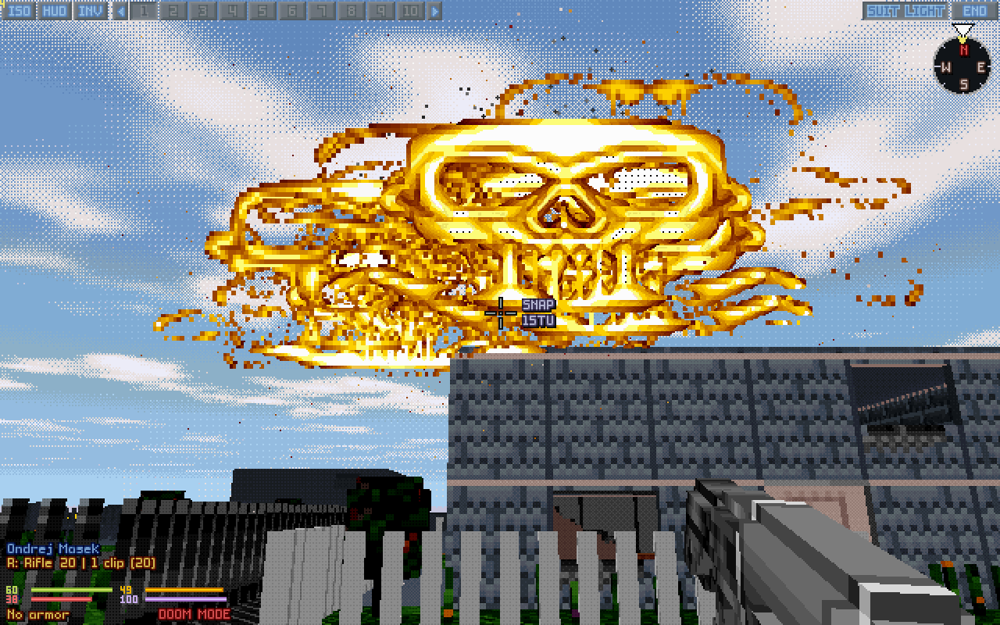
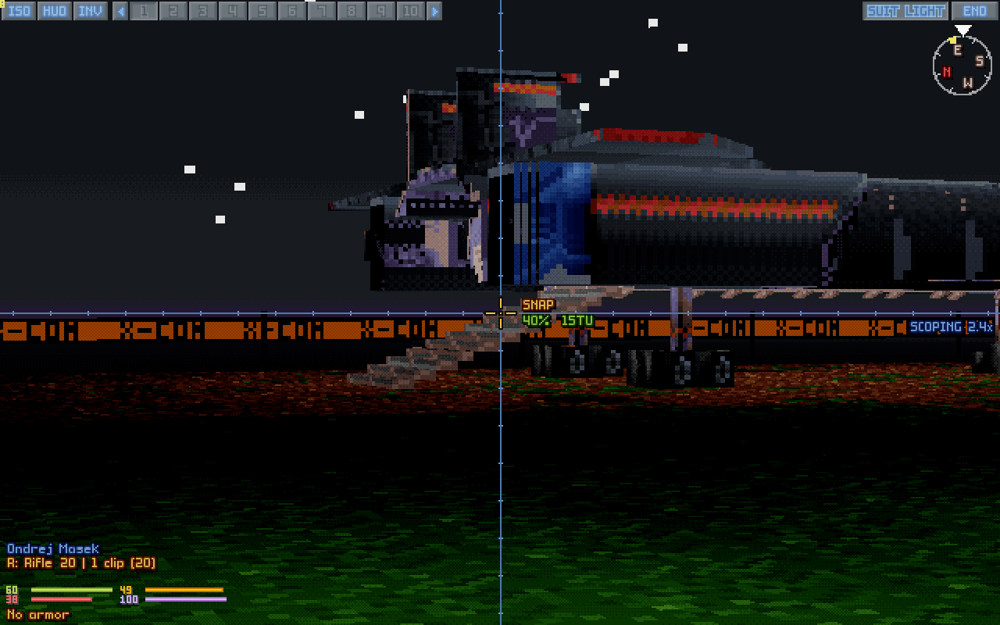

# OpenXcom3D 1.02

*Stand on the battlescape of* UFO: Enemy Unknown *and look around through a soldier's eyes. Now version 1.02.*



It started as a wish from young days, and it has grown, patch by patch, into a game in its own right: the original battlescape, every rule of it intact, seen from inside. More play-testing for this release (Thank You to a specific veteran player for wonderful feedback!). Then the renderer got a long, careful look, to make every frame lighter. It felt like the right moment to call it **1.0**.

Everything still goes through the original game: time units, energy, accuracy, reaction fire, line of sight, doors and morale. Everything new is a setting.

## What's new

### Seeing

- **Smoke you can see through.** The game's own smoke, made truly see-through, turns solid only where your soldier's sight runs out by the game's rules (setting *Smoke*: Modern or Original).
- **UFOs from inside**, without black holes or stripes on their curved walls, and no wall borrowing the texture of what stands opposite it.
- **Doors** that never fold into their walls, **bullet holes** on every wall, and a hit that plays its explosion once.
- **Close by:** a unit right beside you no longer lurches over the camera when you look up.

### Aiming

- **Zoom.** Hold **U**, or the right mouse button, and the view glides in to four times closer: **SCOPING 2.4x** counts it up in blue, and a thin scope cross runs through the reticle. Your aim and your odds stay exactly as they were.
- **The path of a throw**, drawn as you aim, landing where the game will land it (*Show trajectory*: arcs, or every shot), and **Confirm fire** for those who like to click twice.
- **The compass** tells you when a shot will cost time units to turn first.
- **A flashlight of your own**, on and off with **F** (setting *Flashlight*): **On**, a wide beam in the dark, or **Dynamic**, a light on the weapon, a bright spot right on the crosshair that lights dark places day or night.



### Fighting

- **Melee weapons** held tip up and swung down at the crosshair; fists and built-in weapons on **G**.
- **Medi-kits and the motion scanner** straight from the crosshair: point at the patient.
- **Icons over downed units** (burning, bleeding, shock, out cold), the **name of the unit** under the crosshair, and a middle click that identifies it.
- A light switched on can be switched off again (**UNPRIME**). A tank's cannon or a dog's bite no longer shows up as a weapon in empty hands.
- **Doom mode:** every action is free. With *Doom real-time grenades* on, you just throw: you hear the pin, the grenade goes off a few seconds after it leaves your hand, and **FUSE** sets those seconds (1 to 5, picked like the map's timer) for every grenade after. Or, with *Doom prime on throw* off, pull the pin first and cook it. And with *Doom free grenades with airburst* a grenade flies wherever you point it, and bursts in the air if its fuse runs out first.

### Moving

- Stairs that 0.9 couldn't climb, and a step to the side that keeps your facing.
- **Lean** is held with **Left Shift + A / D**, so **Q** and **E** are the hand keys again.

### The aliens' turn

With *Aliens' turn cameras* on, the view goes where the action is. It cuts to the nearest soldier who sees the alien moving, and to anyone firing back. A soldier who is shot at, hit, mind controlled or going down pops up their helmet camera (that last one has its own setting).

## Faster

The renderer was taken apart and put back together, one proven step at a time, and the picture stayed exactly the same, pixel for pixel. Whole frames are now **20–32% faster** at 1280×800: the ray walk is 1.6 to 2 times faster, and units, items, smoke and colour washes are drawn on every core. It is faster on every machine tried, from one core to twenty-two.

## Download

You need your own copy of *UFO: Enemy Unknown / X-COM: UFO Defense* and/or *X-COM: Terror From The Deep*. Nothing of it is included.

- **`OpenXcom3D-1.02-x86_64.AppImage`**: one file. Make it executable and run it.
- **`OpenXcom3D-1.02-linux-x86_64.tar.gz`**: unpack it anywhere and run `./play.sh`.

Both run on any 64-bit Linux from 2021 on (Ubuntu 22.04 and newer, Debian 12, Fedora, Arch, the Steam Deck) and find your games in your Steam library by themselves. Every key, setting and step is in the [manual](../../OpenXcom3D_manual.md). Windows and macOS builds are very welcome from anyone who has the machine for it.

SHA256:

```
a836feb0f3ce359faa6e25877da36237be7b04170e414592d29376948f9ece84  OpenXcom3D-1.02-x86_64.AppImage
b1595f03ba24fb69ce29e4626b160b9365c4d6f5338fea17154b3f8072c705d9  OpenXcom3D-1.02-linux-x86_64.tar.gz
```

## Thank you

To the play-tester whose reports shaped this release; to the **OpenXcom** and **OpenXcom Extended** developers, who keep this game alive; and to **John Carmack** and **id Software**, whose ray casters this view descends from.

**But be careful!** It can still be a traumatic experience.

I wish you all health, and enjoy playing.

---

**1.01: light fixes.** The flashlight got its own key, **F**, apart from the suit light (L), and one setting, *Flashlight*: Off, On or Dynamic (next fire mode moved to **J**, and the mouse wheel). A right click on a soldier's button opens their **SOLDIER CAM**, their helmet camera big, to look through anyone in the squad without switching to them. Then every key and setting was gone over once more: a key that can't act now says why, *Muzzle flashes* off stops every flash, *Shot info* no longer needs the crosshair, and more small fixes (all in the [manual](../../OpenXcom3D_manual.md#11-version-history)).

**1.02: gunplay.** Every gun fires its own round now, bigger for a bigger gun: pistol, rifle, auto-cannon, heavy cannon (and the lasers, the plasma guns and the TFTD guns the same way), with a tracer streak, a muzzle flash and a kick to match. Lasers are red beams again, and every shot leaves the muzzle of the hand that holds the gun, whatever the *Particles* setting (which now reads Off, Effects or All). Rockets and torpedoes leave smoke and white specks that hang in the air for half a minute. Every weapon in hand lies barrel first along the line to the crosshair. *Smoke* comes in two kinds now, **Original** and **Modern**: Original, the game's own smoke animation, closes up where your soldier can't see through a cloud, so a smoke grenade really hides what's behind it. And in Doom mode a grenade thrown from its menu can't be thrown again (all in the [manual](../../OpenXcom3D_manual.md#11-version-history)).
