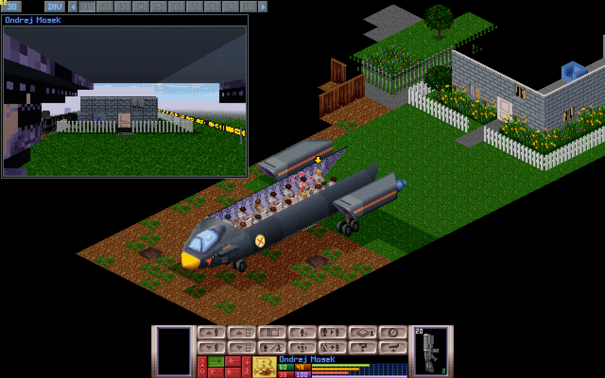
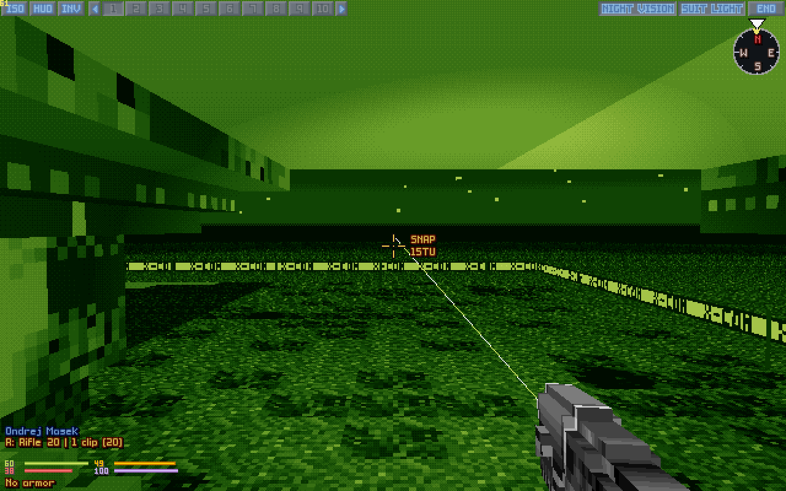
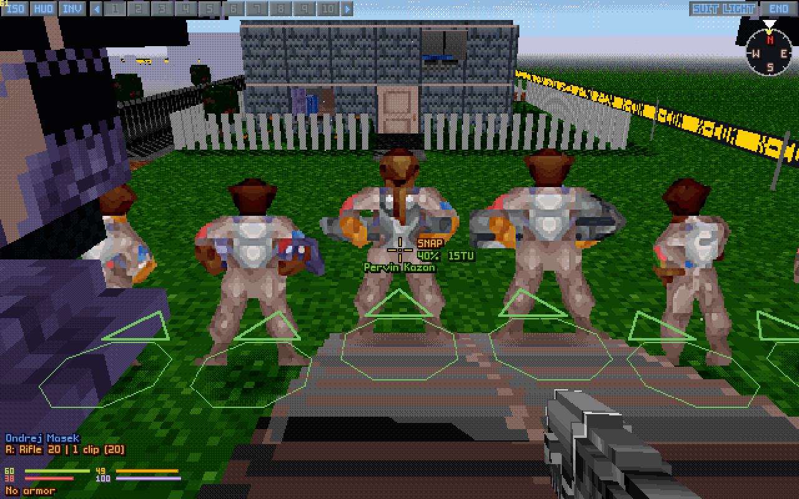
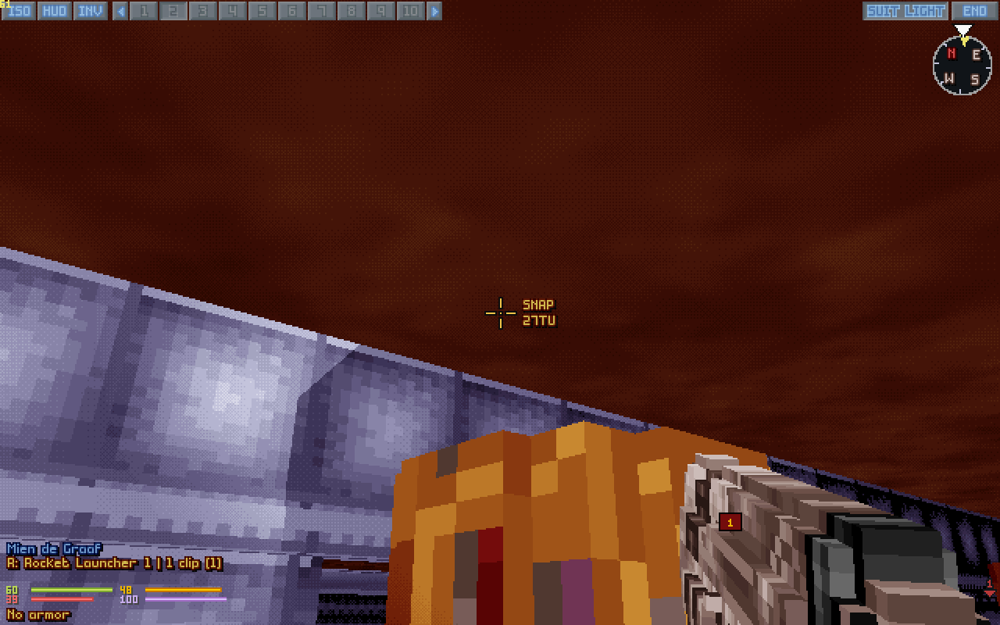
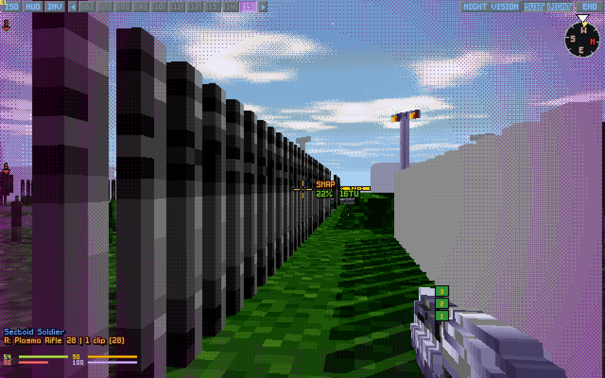

# OpenXcom3D 1.04

*Stand on the battlescape of* UFO: Enemy Unknown *and look around through a soldier's eyes. Now version 1.04: two more play reports turned into thirty-four patches.*



The same veteran player sent two more reports on 1.03, a long one and a short one (Thank You again!), and every point in them became a patch, talked over and tested one at a time. The big mods were in the reports too, XPiratez most of all.

Everything still goes through the original game: time units, energy, accuracy, reaction fire, line of sight, doors and morale. Everything new is a setting.

## New in 1.04

### The map camera

A window on the isometric map with the selected soldier's helmet camera, looking the way they face, or at the target while you aim on the map (setting *Map camera*: small, medium or large). **P** shows or hides it, a click on it goes to 3D, and a right click opens the soldier cam there.

### Aiming that tells the truth

No more "No line of fire" with your shot plainly on the unit. When the line from your gun to the exact point under the crosshair is blocked, the shot now goes as the game's own aim would: at any part of the unit a line reaches, and left and right of centre with OXCE's *Off-centre shooting*. A unit's head poking up into the tile above (on stairs, on raised ground) can be hit at last. A shot the game will still refuse shows its path dimmed, a dotted dark red, so the refusal never comes as a surprise. **Force arcing shots** fires a Panzerfaust at a building's side, its path yellow, and the new **Force blocked shots** (off) fires anyway when nothing reaches, the accuracy roll deciding whether the round clears the cover.

Under night vision the aimed path glares white-green, as a laser sight does through goggles.



### Which way they face

Hold **Left Alt**: every unit in sight gets a ring with an arrow on the floor, the way it faces, in its side's colour, drawn over everything. For the units whose sprites don't show it.



### Underground

Bases, colonies and caves now sit in their own rock: rock beyond the map's edges, and a rock ceiling instead of the sky, in the map's own colours. Unexplored terrain turns misty with distance, instead of a phantom skyline of slate boxes.



### Under your control

Look through an alien you've taken over and the edges of the view are washed purple, breathing gently, and its button on the top bar shows its number in purple.



### Gunplay

- **Akimbo:** two guns together cost the dearer gun's shot and a tenth more, not twice, and each is 30% less accurate instead of half. Or fire them one a moment after the other, each at full accuracy and its own cost (*Akimbo in turn*, with a key of its own). Guns that arc fire in turn, two guns take no aimed shot, and a shotgun in either hand fires its pellets.
- **Shotgun pellets in flight** (setting, off): each pellet flies beside the round, to where the game's spread sends it.
- **Bullet holes on everything**, near and far, drawn in 3D: a far one a dot, a near one with a darker core, on slopes and objects as on walls.
- **At the map's pace:** chains of explosions and fast bursts (the X-Com Files' turbo laser) no longer crawl in 3D on slower computers.
- **Soldiers spawn with guns:** OXCE's own auto-equip handed out staffs, pitchforks and stop signs first in the big mods, and other weapons each time the mod list changed. Now guns come first, the same every time.

### Moving

- **Doors:** **O** opens the door you look at, turning to it first, and tile moves stop in front of a closed door instead of walking on through it.
- **Falls, climbing and flying** go by the walking speed now, and a fall speeds up as gravity would.
- **No surprise steps:** with tile moves a key pressed during a shot no longer walks once the shot is over, and with paid turns looking round mid-shot no longer turns the soldier afterwards.
- **Night vision** switches at any time, in the middle of a chain of explosions too.

### Fixed

- **A big unit's corpse** lies in one piece instead of four chopped parts.
- **Items lie on slopes** instead of sinking into them.
- **Black only where it's dark:** a burnt floor in a lit room is no longer a black hole.
- **The Abductor** has no grass left in its corners, and **ghost lift pads** stay see-through up close.
- **On a tall crate under a ceiling** the view no longer squeezes into a slit, and the shot clears what you stand on.

All of it, with every key and setting, is in the [manual](../../OpenXcom3D_manual.md#11-version-history).

## And around it

- **macOS:** a first build, for Apple silicon and Intel, made by the automatic builds and untested on a real Mac. Mac testers can take it from the latest run's *Artifacts* ([how](../../OpenXcom3D_manual.md#option-a-on-macos-a-first-untested-build)).
- **The build guide** on GitHub Pages: [b0realis.github.io/OpenXcom3D](https://b0realis.github.io/OpenXcom3D/), every step for Linux, Windows with MinGW and the Windows build on Linux. Its commands are checked automatically, on six Linux distributions and in MSYS2 on Windows.
- **The mod switches itself on** the first time the game finds it in a profile.

## Download

You need your own copy of *UFO: Enemy Unknown / X-COM: UFO Defense* and/or *X-COM: Terror From The Deep*. Nothing of it is included.

- **`OpenXcom3D-1.04-x86_64.AppImage`**: one file. Make it executable and run it.
- **`OpenXcom3D-1.04-linux-x86_64.tar.gz`**: unpack it anywhere and run `./play.sh`.
- **`OpenXcom3D-1.04-windows-x86_64.zip`**: for 64-bit Windows 10 and 11. Unpack it somewhere of yours (Documents, the Desktop, `C:\Games`; not Program Files) and double-click `play.bat`. The game isn't signed, so Windows may warn the first time: *More info*, then *Run anyway*.

The Linux ones run on any 64-bit Linux from 2021 on (Ubuntu 22.04 and newer, Debian 12, Fedora, Arch, the Steam Deck). All three find your games in your Steam library by themselves. Every key, setting and step is in the [manual](../../OpenXcom3D_manual.md).

SHA256:

```
f74da68527dd3f01269a3f325d0ee7b1eb438d97f985d54b151fdc1c6c2ed187  OpenXcom3D-1.04-x86_64.AppImage
663b11a2fd7bee4b0ce646b5365c4aa39ac380312cddf176883989b39058f901  OpenXcom3D-1.04-linux-x86_64.tar.gz
15c303d2e64dfe16009f3353e814e9fd1538d90cc3cc43d36606a61cd168a032  OpenXcom3D-1.04-windows-x86_64.zip
```

## Thank you

To the play-tester whose reports shaped this release, point by point; to the **OpenXcom** and **OpenXcom Extended** developers, who keep this game alive; and to **John Carmack** and **id Software**, whose ray casters this view descends from.

**But be careful!** It can still be a traumatic experience.

I wish you all health, and enjoy playing.
