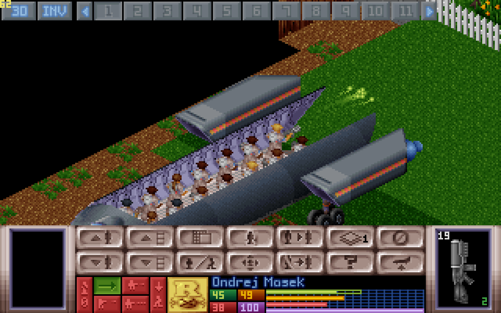

# OpenXcom3D 1.05

*Stand on the battlescape of* UFO: Enemy Unknown *and look around through a soldier's eyes. Now version 1.05: more of a veteran player's reports, and a crash found from their log.*

> **New here? ▶ [How to play these downloads](https://b0realis.github.io/OpenXcom3D/play.html)**, on Linux, Windows, the Steam Deck or macOS, and where your UFO and TFTD data goes. Rather compile it? **⚙ [The build guide](https://b0realis.github.io/OpenXcom3D/)**.


Patches 125–136, from a veteran player's play reports on 1.04, each one discussed, built and tested on its own: a robust step per patch, then the full suite (AddressSanitizer, ThreadSanitizer) on the final code. The crash came with the player's log. Its `[FATAL]` backtrace, resolved against a debug-info rebuild of 1.04's exact source (its `.text` byte-identical to the release binary's), pointed into `State::~State()`. Under ASan it reproduced as a heap-use-after-free: every window resize event remade the 3D views (the inventory freeze) and left the old surfaces in the battlescape screen's owned-surface list, freed a second time when the battle ended.

Everything still goes through the original game: time units, energy, accuracy, reaction fire, line of sight, doors and morale. Everything new is a setting.

## New in 1.05

### A crash ending a battle, fixed

Abandoning a long mission could crash the game, and opening the inventory could freeze it for a moment. Each time the game's window was resized (a window manager can do it on every change of screen size, as the inventory's own makes), the 3D views were made again, which was the freeze, and the old ones were left to be deleted a second time when the battle ended: the crash, the likelier the longer the mission. Now a resize that changes nothing is let be, the 3D views are made again only when their size really changes, and nothing is deleted twice.

### Helmet cameras that feel live

The map camera now has the soldier cam's blinking red dot, and both cameras get TV static only now and then: a spell rising from nothing to a snowstorm and back, each at its own pace, 10 seconds to 2 minutes apart, instead of a steady sprinkle. On the hardest missions and inside UFOs a little static stays all the time and the spells come more often; every camera glitches more often, now and then tearing, on any mission.

### The top bar across the top

On a bigger screen the soldiers stand in the middle of the top bar and the other buttons at its edges, as on the original screen; a wide screen shows more than ten soldiers when they fit, and on the map INV takes the hidden HUD button's place.


### Gunplay

- **Akimbo in turn** is akimbo but for the turn: the same 30% penalty and cost as two guns together, the second round a moment after the first, both flying 30% faster so the pair isn't slower.
- **Shotguns on the map:** with *Shotgun pellets in flight* the pellets fly on the isometric map as in 3D, the other gun's round of an akimbo pair too, and a mod's shotgun without a bullet sprite borrows the one its damage type's ammo uses most. Every pellet now lands with its sound and, in 3D, its sparks and bullet hole.
- **Arcing shots at the exact point:** a grenade launcher (a Panzerfaust in the big mods) aims at the spot under the crosshair, a forced shot too, instead of the tile's middle or its corner.
- **Shorter rocket trails:** a rocket's lasting specks hang about ten seconds, not half a minute.



### And more

- **Primed grenades say turns:** PRIMED 3 turns, PRIMED 1 turn, PRIMED this turn.
- **Doom mode's grenades always burn in real time:** the separate setting is gone.
- **Auto-equip is OXCE's own again,** unchanged, as modders rank their own items for it (1.04 handed out guns first).

All of it, with every key and setting, is in the [manual](../../OpenXcom3D_manual.md#11-version-history).

## Download

You need your own copy of *UFO: Enemy Unknown / X-COM: UFO Defense* and/or *X-COM: Terror From The Deep*. Nothing of it is included.

- **`OpenXcom3D-1.05-x86_64.AppImage`**: one file. Make it executable and run it.
- **`OpenXcom3D-1.05-linux-x86_64.tar.gz`**: unpack it anywhere and run `./play.sh`.
- **`OpenXcom3D-1.05-windows-x86_64.zip`**: for 64-bit Windows 10 and 11. Unpack it somewhere of yours (Documents, the Desktop, `C:\Games`; not Program Files) and double-click `play.bat`. The game isn't signed, so Windows may warn the first time: *More info*, then *Run anyway*.

The Linux ones run on any 64-bit Linux from 2021 on (Ubuntu 22.04 and newer, Debian 12, Fedora, Arch, the Steam Deck). All three find your games in your Steam library by themselves. Every key, setting and step is in the [manual](../../OpenXcom3D_manual.md). A first macOS build, untested on a real Mac, comes from the automatic builds ([how](../../OpenXcom3D_manual.md#option-a-on-macos-a-first-untested-build)).

SHA256:

```
159a11d4ef5ec5695a00eda30d62161f5d34b446cabf08350f1c4c8abf9f2781  OpenXcom3D-1.05-x86_64.AppImage
5a5b2a145e6dc4f4980413c6c75558cf1d749e63bf78ef040a2f156bda17c954  OpenXcom3D-1.05-linux-x86_64.tar.gz
c9eefb0900a0a309c2ceb46c50fcb4c6016b9b5dda9f840dde68d6322b534e7d  OpenXcom3D-1.05-windows-x86_64.zip
```

## Thank you

To the play-tester whose reports and crash log shaped this release; to the **OpenXcom** and **OpenXcom Extended** developers, who keep this game alive; and to **John Carmack** and **id Software**, whose ray casters this view descends from.

**But be careful!** It can still be a traumatic experience.

I wish you all health, and enjoy playing.
