# OpenXcom3D 1.08

*Stand on the battlescape of* UFO: Enemy Unknown *and look around through a soldier's eyes. Now version 1.08: a shotgun whose every pellet counts, akimbo on the isometric map, Terror From The Deep's sea rolling in waves, and rooms in their own light.*

> **New here? ▶ [How to play these downloads](https://b0realis.github.io/OpenXcom3D/play.html)**, on Linux, Windows, the Steam Deck or macOS, and where your UFO and TFTD data goes. Rather compile it? **⚙ [The build guide](https://b0realis.github.io/OpenXcom3D/)**.

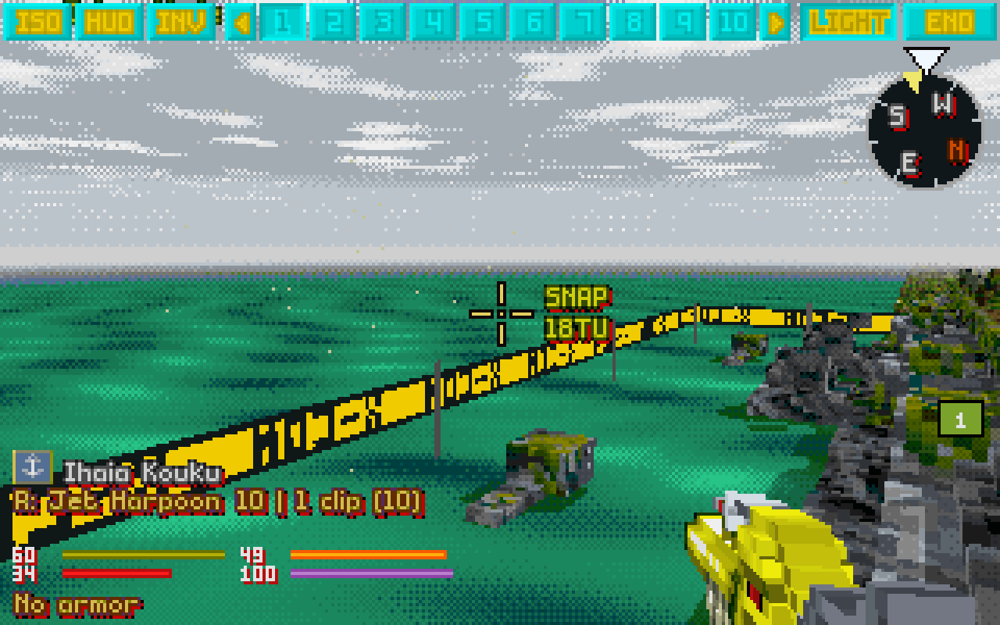

Patches 168–172: the two things found while taking 1.07's pictures, the sea in waves, a play report on OXCE's "shotgun void", and akimbo on the map, each discussed, built and tested on its own (a robust step per patch, with a new test mod that spreads a shotgun wide and a save with a shotgun in each hand), then the full suite (AddressSanitizer, ThreadSanitizer) on the final code. In OXCE a shotgun's blast is its lead pellet's: only that one is traced as it's fired, the others when it lands, and when it flies off the map none at all. Now the round and its pellets, and an akimbo volley's two rounds, fly as one group in which each lands on its own; the last to land in the map brings the game's own explosion state, with the deaths and the walls, so everything else stays the game's.

Everything still goes through the original game: time units, energy, accuracy, reaction fire, line of sight, doors and morale. Everything new is a setting or the game's own rule.

This release also carries what 1.05, 1.06 and 1.07 brought, below the new things: their releases are folded into this one.

## New in 1.08

### Every pellet counts

A player found it: with a shotgun, **the lead pellet decided the whole blast**. When it flew off the map, over a target into the sky or past one at the map's edge, **every pellet was lost with it**, even those that would have hit (OXCE traces the others only when the lead one lands). And with *Shotgun pellets in flight* the pellets waited in the air for it, or were cut short. Now, with the new setting *Each pellet on its own* (on), **none is lost**, and in flight **each hits as it gets there**; the deaths come with the last to land, as the game's come with its round. The misses still flying then fly on to the map's edge, only to be seen: nothing waits for them.

- In 3D **every pellet is drawn as a round**, so no pellet looks special (the lead one had a real round's look, "all others are weird wireframe squiggles").
- With FPS-style shooting **the pellets spread again**: they all flew down the round's own line.
- **An akimbo volley's two rounds** land on their own too: the other round no longer hangs in the air when the first one leaves the map.
- Off, it's OXCE's own way, in both views.

### Akimbo on the map

A soldier with a gun in each hand can fire both from the **isometric map** too: hold **Ctrl+Shift** and click either hand's weapon. One click: **both at once**, a mini target by each gun; two: **in turn**; three: off. Then fire as usual from the clicked gun's menu, and the other gun fires its mode of the same kind, as akimbo does in 3D. It's kept with the soldier in the save.

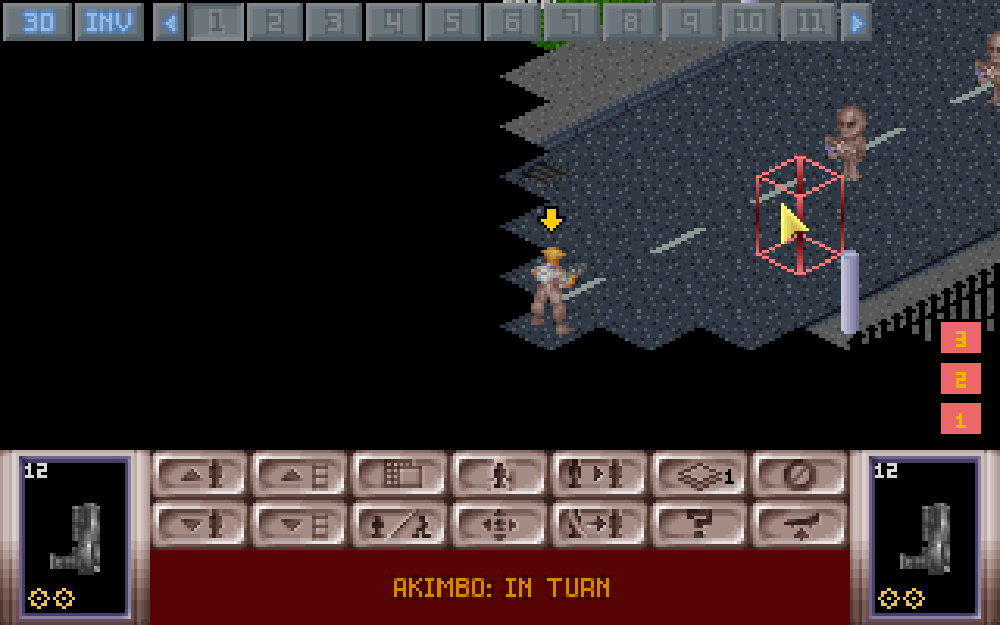

### The sea in waves

Terror From The Deep's sea now **rolls in waves**: swells crossing at their own lengths and speeds in the sea's own colours, lighter crests breaking into foam, deeper teal in the troughs. And **where the sea reaches the map's edge it goes on past it**: an island's shore runs on out of the map, where the island's grass used to stretch to the horizon. The near-black edge of the sea's tiles no longer draws a grid on it.

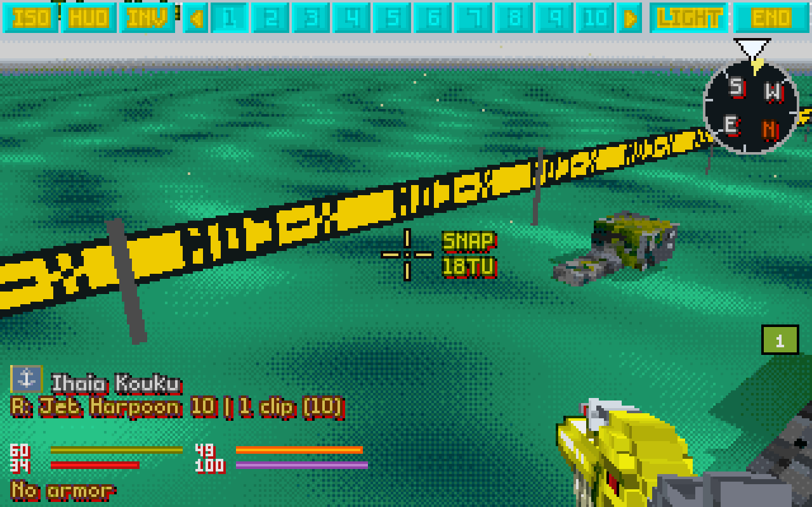

### Rooms in their own light

The 3D view shaded every wall by the sun, indoors too: a wall turned away from it three shades darker, one facing it from under the roof three more, on top of the room's own light, so a shop's grey inside wall came out black. **Indoors no sun shines now**: walls and floors are lit by the room as on the map.

## From 1.07

Two play reports on 1.06 (patches 159–167): akimbo's burst through OXCE's own burst loop, the original games' shapeless fittings given shapes from a scan of every terrain record, and glass seen through.

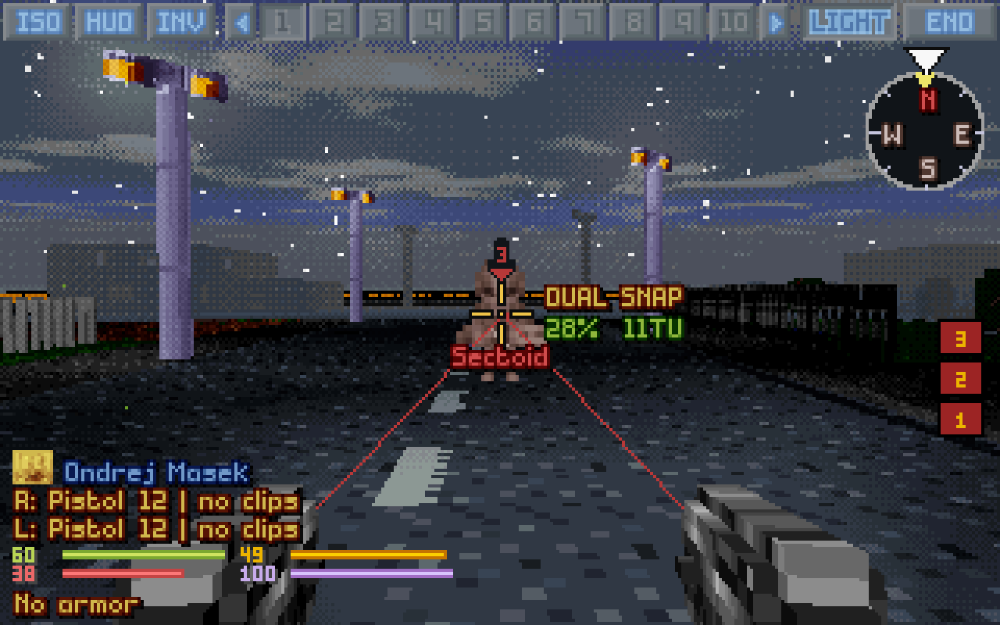

### Two guns that take turns

Akimbo fired like a two-pellet shotgun: both rounds aimed at the same moment, landing together, their deaths and broken walls counted once, so a pair couldn't burst through two aliens in a row. Now the guns **take turns round by round**, the chosen gun first, and each round is a round of its own, as an auto burst's: aimed as it leaves, its hit, deaths and destroyed walls worked out before the next one goes. **Each gun fires its whole burst**: XPiratez's Linux Mandrake (4 rounds) beside the Origami (5) fired 4 and 1; now 4 and 5, the longer one finishing alone, and the crosshair counts them (DUAL AUTO x9). With *Show trajectory*, **both guns show their laser**, each from its own muzzle.

The old way stays as *Akimbo volley*: both at once, and a round that gets there first now shows its hit at once instead of hanging in the air until the other lands.

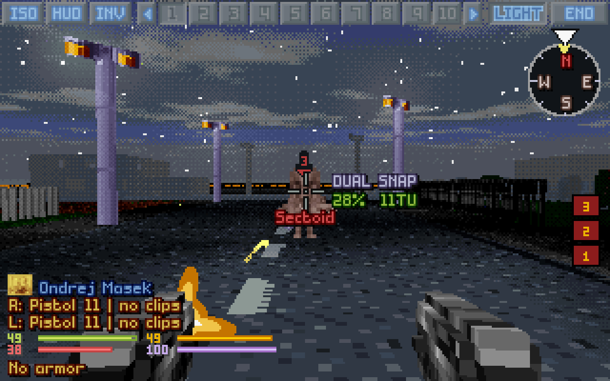

### Seen as on the map

- **Shapes for the parts without voxels:** UFO's shop racks, solid things on the map but nothing to the game, were invisible in 3D; now they stand as see-through ghosts of four legs, two shelves and their goods (a third fainter than a ladder's, as no one can walk into them). TFTD's platform in the liner's hold, the foam along its hull, the sunken plane's door frames, the box on the Triton's back and a few more get theirs too.
- **TFTD's sea is water:** on the island, port and ship maps the sea had no floor in 3D, so the grass under the map showed through it. Now it's water up to the map's edge, as on the map (and since 1.08 past it).
- **Glass you can see through:** the gas station's glass doors, TFTD's chain-link fences and gates, the gaps in a fence: where the art is see-through on the map, the 3D view sees through too. Bullets still stop there, as the game says.

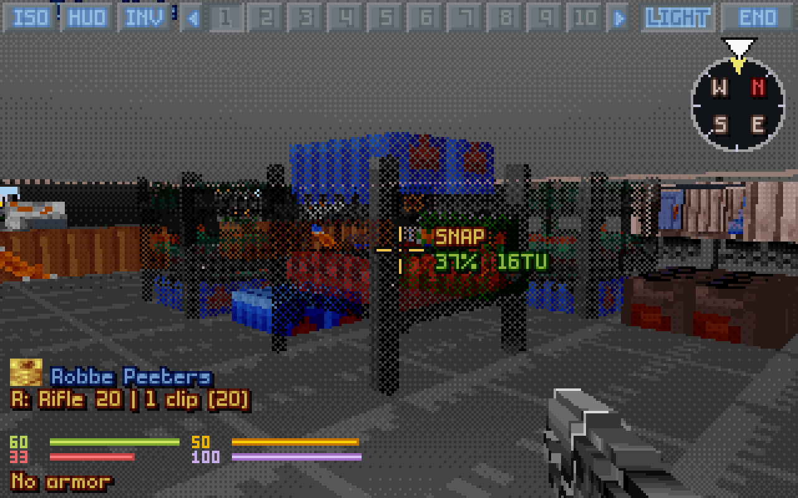

### And more

- **Units on a floor above stay up there:** their feet no longer hang through the ceiling of the room below.
- **A mod's own fire mode names** on the crosshair: X-Com Files' XM29 says LAUNCH MISSILE, XPiratez's guns QUICKBURST, PUNCH! and the rest.
- **The glow over black takes the light's colour:** on TFTD's night a green hitbox, a laser or fireflies glowed a creepy red; now each glows its own colour.
- **A shotgun no longer slows the isometric map down:** with *Shotgun pellets in flight* every map frame took 22–46 ms while the pellets flew; now about 1.3 ms.


## From 1.06

Four play reports on 1.05 (patches 137–158). Most of it moved decisions from the facing tile to the crosshair: melee and medi-kits resolve their target from the voxel and unit pictures under it, the spray burst reuses OXCE's own targeting, and the cost line reads the game's own rules.

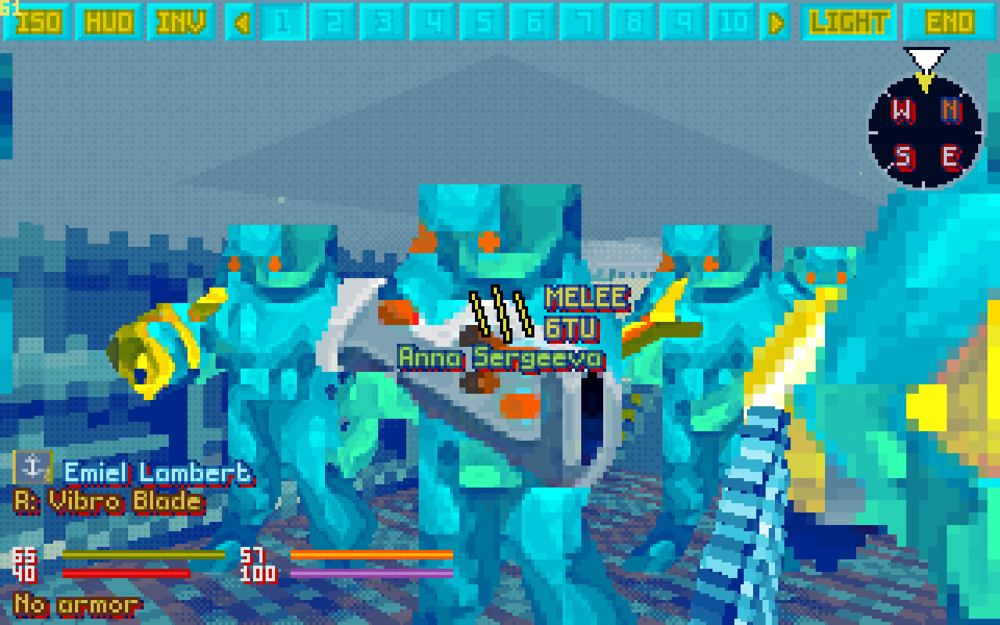

### Everything by the crosshair

- **Melee** strikes the wall, door or object under the crosshair on the soldier's own tile or any next to it, diagonally and a level up or down too: on stairs, the walls of both floors ahead (with *Melee hits walls and downed*, or a mod's terrain melee).
- **Medi-kits** treat whoever is under the crosshair on a tile beside you, turning to face them first (paid with *Turning costs TU*), or the body at your feet; a unit farther off is out of range, and a body elsewhere asks you to stand over it.
- **Every cost of an action** on a third line under the hit chance (*Expanded crosshair info*): energy, health, stun, morale and mana, a cost the soldier can't pay in red.

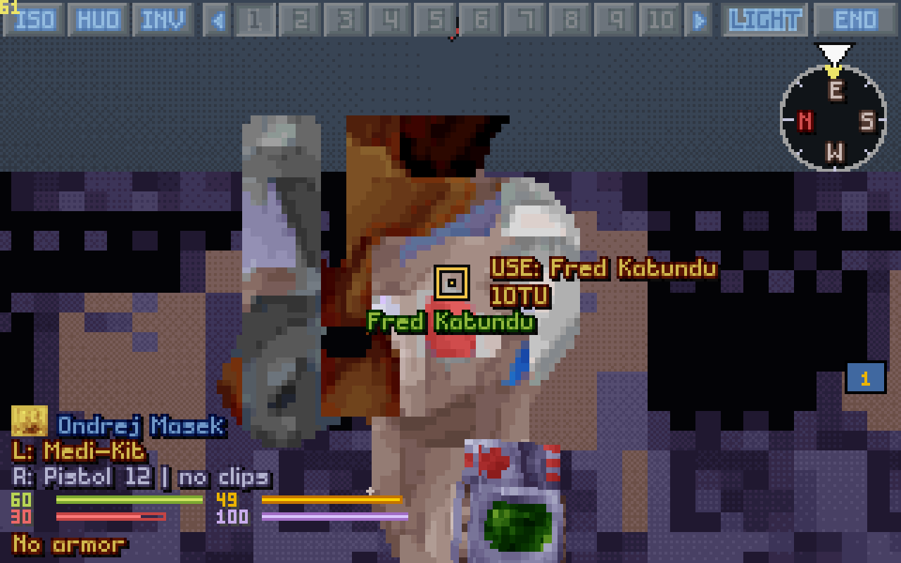

### Spray bursts

The big mods' miniguns and machine guns sweep their burst between points. In 3D as on the map: with the auto shot, **Ctrl+Shift and a click** marks the first point, each click the next, and the last fires; the right button takes one back. Each point stands in the view as a light green pole with a mini target where the rounds will go.

### Flying with the view

With flight on, **W looking up flies straight up** and looking down comes down, as on a grav lift, level by level while held. Arrows beside the compass show where W can climb from here, the one it takes now lit.

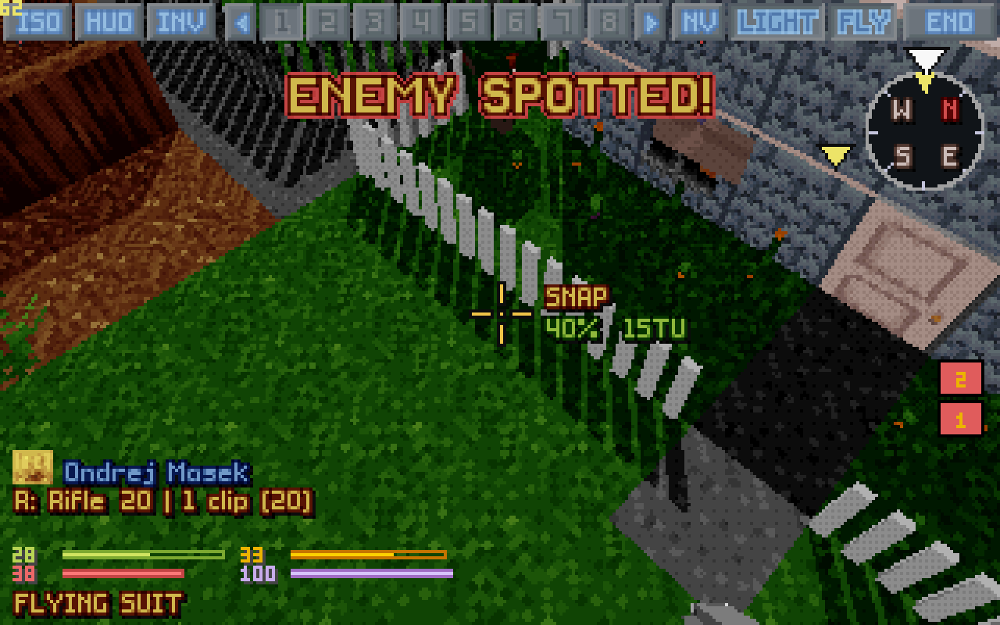

### Seeing, and more

- **Heat vision thins the smoke you see**; **shots into the sky just vanish**; **Cydonia's lift bars stand round the lift like a cage**; **Ghost opacity** (10 to 100%) sets how solid the parts without shape look; **items on stairs** lie over the steps.
- **The soldier's rank before the name** (a mod's own tiny ranks, or the game's badge made small), **numpad diagonals**, **a 2×2 unit no longer blinded** in a two-tile door, and **a weapon drawn on a slant lies along the gun**.

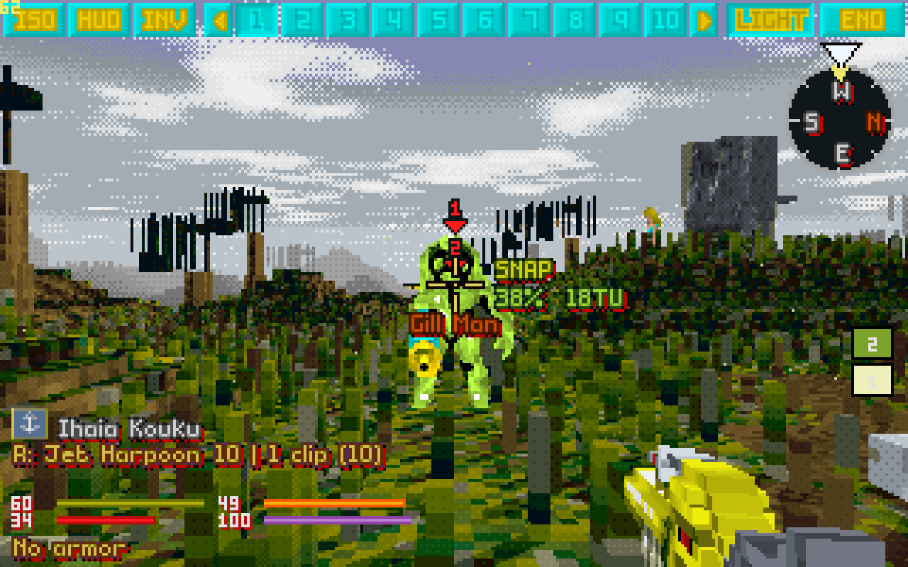

## From 1.05

A veteran player's reports on 1.04 (patches 125–136), and a crash found from their log: every window resize event remade the 3D views and left the old surfaces to be freed a second time when the battle ended.

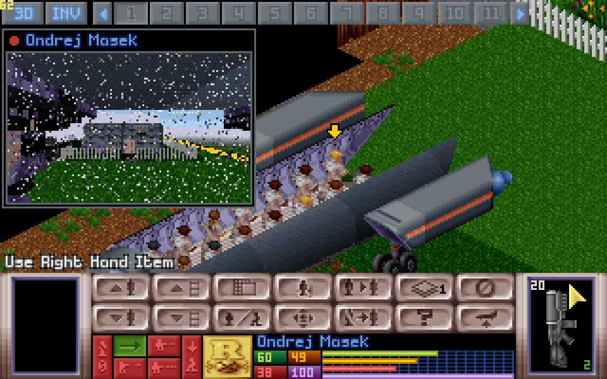

- **A crash ending a long battle, fixed,** and the inventory's brief freeze with it: the 3D views are made again only when their size really changes, and nothing is deleted twice.
- **Helmet cameras that feel live:** the map camera has the soldier cam's blinking red dot, and both get TV static in spells, rising from nothing to a snowstorm and back, 10 seconds to 2 minutes apart (more often on the hardest missions and inside UFOs, now and then tearing).
- **The top bar across the top:** on a bigger screen the soldiers stand in the middle of the top bar and the other buttons at its edges; a wide screen shows more than ten soldiers when they fit.
- **Shotguns on the map:** with *Shotgun pellets in flight* the pellets fly on the isometric map as in 3D (since 1.07 without slowing it down), and every pellet lands with its sound and, in 3D, its sparks and hole. **Arcing shots** aim at the exact point under the crosshair; **rocket trails** hang about ten seconds; **primed grenades** say their turns; **auto-equip** is OXCE's own again.

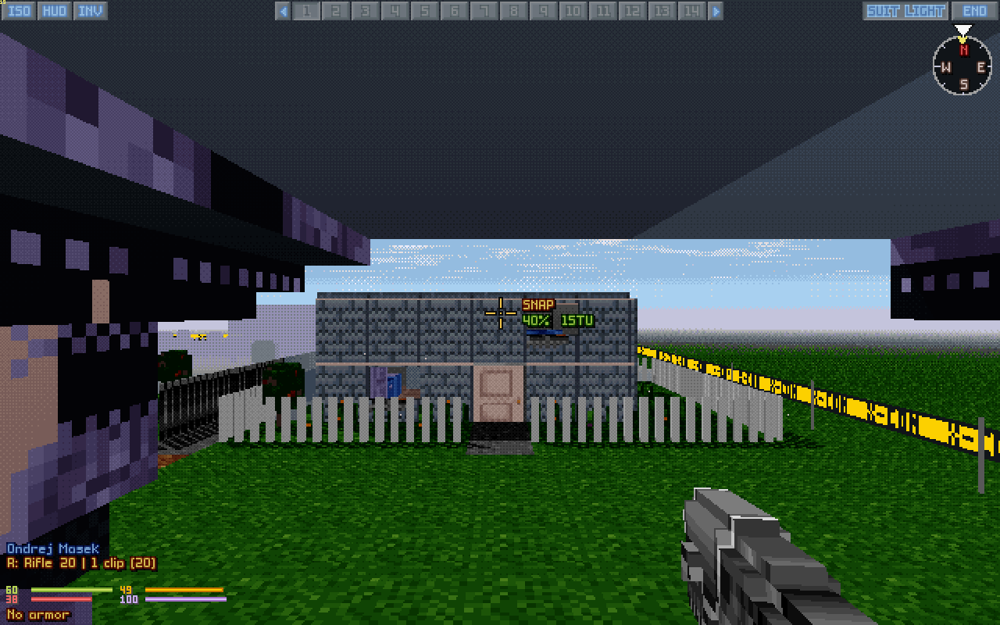

All of it, with every key and setting, is in the [manual](../../OpenXcom3D_manual.md#11-version-history).

## Download

You need your own copy of *UFO: Enemy Unknown / X-COM: UFO Defense* and/or *X-COM: Terror From The Deep*. Nothing of it is included.

- **`OpenXcom3D-1.08-x86_64.AppImage`**: one file. Make it executable and run it.
- **`OpenXcom3D-1.08-linux-x86_64.tar.gz`**: unpack it anywhere and run `./play.sh`.
- **`OpenXcom3D-1.08-windows-x86_64.zip`**: for 64-bit Windows 10 and 11. Unpack it somewhere of yours (Documents, the Desktop, `C:\Games`; not Program Files) and double-click `play.bat`. The game isn't signed, so Windows may warn the first time: *More info*, then *Run anyway*.

The Linux ones run on any 64-bit Linux from 2021 on (Ubuntu 22.04 and newer, Debian 12, Fedora, Arch, the Steam Deck). All three find your games in your Steam library by themselves. Every key, setting and step is in the [manual](../../OpenXcom3D_manual.md). A first macOS build, untested on a real Mac, comes from the automatic builds ([how](../../OpenXcom3D_manual.md#option-a-on-macos-a-first-untested-build)).

SHA256:

```
c37177b0d69fb385abf790957093724c159819c32c829159c4b374c4472dfdf0  OpenXcom3D-1.08-x86_64.AppImage
87427c0a2b421916fa8141475793fa664f11b81dcb6fa8df7a087696884e6ea4  OpenXcom3D-1.08-linux-x86_64.tar.gz
56a45e8edc454df7e218513f13327a818fd09f8f2a06e2c2843fdd777fb7d34e  OpenXcom3D-1.08-windows-x86_64.zip
```

## Thank you

To the play-tester whose reports, crash log and screenshots shaped these four releases; to the **OpenXcom** and **OpenXcom Extended** developers, who keep this game alive; to the makers of **XPiratez** and **X-Com Files**, whose worlds keep asking new things of the 3D view; and to **John Carmack** and **id Software**, whose ray casters this view descends from.

**But be careful!** It can still be a traumatic experience.

I wish you all health, and enjoy playing.
