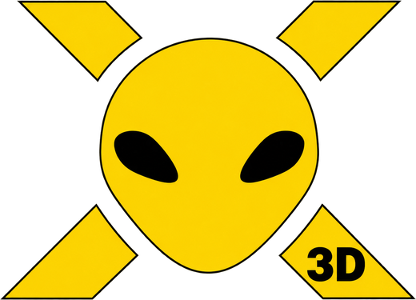

# OpenXcom3D 1.09

*Stand on the battlescape of* UFO: Enemy Unknown *and look around through a soldier's eyes. Now version 1.09: a UFO's light inside it, even and sharp, smoke as thick as you like by day and at night, and a logo of its own.*

> **New here? ▶ [How to play these downloads](https://b0realis.github.io/OpenXcom3D/play.html)**, on Linux, Windows, the Steam Deck or macOS, and where your UFO and TFTD data goes. Then **[every key](https://b0realis.github.io/OpenXcom3D/play.html#keys), [every setting](https://b0realis.github.io/OpenXcom3D/play.html#settings)** and how it plays, the 3D view's icons, and every feature in pictures, on the same page. Rather compile it? **⚙ [The build guide](https://b0realis.github.io/OpenXcom3D/)**.



Playtest reports on UFOs seen from inside, on smoke at night, on a walk through a door that never ended, on shots off the crosshair and on melee by the compass, at floors and straight up, on FPS style's lost snap shot, on names by the picture, on tails in the floor, on corpses in the way and on Page Up, settings for new players, holes under the zoom, a clean view and the motion scanner, full sprite hitboxes, quick deaths, and a logo, each discussed, built and tested on its own (a robust step each), then the full suite.

## A UFO's light inside it, even

Inside a UFO by day, *UFO lights and aura* laid a grid of dots over the whole view. That was the UFO's own light: its colour was mixed in a whole pixel here and there, and inside a UFO its soft light reaches everything. Now the UFO itself, inside and its hull, takes the light's colour **evenly**: twelve strengths of it, each colour kept as bright as it was, so walls and floors stay sharp and keep their detail, and strong colours keep their own (a red lift pad stays red). The ground around the UFO keeps its glowing pool, and the **aura stays outside**: its motes and sparks never start on the UFO's own tiles. The grav lifts' beams of light are as they were.

## Smoke opacity, by day and at night

A player: smoke you can see through "can be blinding for some players", at night and on dark maps. Two new settings: **Smoke opacity** (45%, the look until now) and **Night smoke opacity** (25%, about half). The night value holds on a night mission, however lamps or the suit lights light the smoke (lit smoke on a dark night is the blinding kind), and by day where the smoke hangs in the dark, an alien base or an unlit room. Thicker smoke stays thicker in the same proportion; where your soldier can't see through the smoke at all, it stays solid, by the game's rules.

## No walking on out of the map through a door

A player saw a soldier walk into a door, backwards or sideways, and the view walk on and on, out of the map, while on the map the soldier had stopped. Through a door the view walks on by itself until it is well inside the next tile, a stretch only 6 voxels wide, and one slow frame (a hitch of a tenth of a second) could jump right over it: then it never stopped, and the keys did nothing. Now the step always ends inside the next tile.

## Shots nearer the crosshair

A player's screenshots: shots that went visibly off the crosshair, and lasers along flat ground jutting off to a side. With the game's own targeting, when no line from the gun reaches the very point under the crosshair (the gun is lower than the eye: along a floor its line grazes the bumps on the way, over a counter it meets the edge), the shot went for the game's own aim: the tile's middle, or another part of the unit. Now it first looks for the nearest point, within a quarter tile, whose line meets the same target near the crosshair, and only then falls back on the game's aim. The line of fire and the accuracy are the game's, as before.

And aiming at your own tile (a wall you stand against, the floor at your feet) no longer turns your soldier south first, paying for the turn: an OXCE quirk (its direction to a point straight above or below came out as south), fixed on the isometric map too.

## Melee by the crosshair, not the compass

A player: with the soldier facing north, a blow aimed at a cabinet to the north-west struck the unit to the north, and aimed at that unit while facing north-west, it struck the cabinet. Melee went the way the soldier faced, and with *Turning costs TU* the head looks 45° round for free. Now a blow strikes what the crosshair is on: a unit beside you, diagonally too, turning to face them first (paid with *Turning costs TU*, shown on the compass as HIT +1 TU); a unit farther off is out of range; a wall, door or object within reach takes the blow when terrain melee is on, and otherwise nothing is struck. Only with the crosshair on none of these does the blow go the way you face, as on the map.

## Melee at floors, ceilings and straight up

The same player: melee couldn't reach floors above or below, or a unit straight above you on a lift. With terrain melee on, a new setting, **Melee hits floors** (on by default), lets a blow strike the floor or ceiling under the crosshair by the game's own hit, its damage and the floor's armour, the game's falling if it breaks. A unit straight above or below you is struck when the game's own line from the blow reaches it, never through a wall or floor (on a UFO lift the upper pad lies between, so a unit on the next level stays out of reach).

## The snap shot back in FPS style

The same player: in FPS style (*Faithful X-COM targeting* off) the snap shot had vanished: the quick slot (Z) of a gun with an auto shot fired one burst, which a click on AUTO already does. Now Z fires the game's single snap shot again, its time units and the hip's wider spread; AUTO fires a burst on a click and keeps firing while held.

## The unit pointed at, by its hitbox

The same player: the name under the crosshair showed only while a pixel of the unit's picture was there, and X-Com Files' small, oddly moving swarmids made it blink. Now the unit you point at, for its name, the middle click, a medi-kit's patient and a melee blow, is the one whose hitbox the game's own line meets, as a shot would; its picture counts only when the line meets no unit (a unit far off, a few pixels across).

## Tails on the floor, not in it

The same player: X-Com Files' Asmodean Cobra sank into the ground in some rotations. A unit is drawn on an upright card at its feet, and what the isometric art draws below the feet (a Snakeman's tail, a long body in some facings) went under the floor, ending in a straight cut. Now that part lies flat on the floor in front of the unit, as items do; for most units that's only a few pixels of the feet. A unit in the air keeps the upright card.

## See-through corpses

The same player: very tall corpses (XPiratez's boomasaurs and mongorns) hid what a shot reaches, though the game's shots pass through items. A new setting, **See-through corpses** (off at first): the corpse or item under the crosshair is drawn faint, at the ghost opacity, while you aim past it at a unit, a wall or another floor; aimed at the floor it lies on, it stays solid.

## Page Up flies

The same player: with flight off, Page Up only said "Flight off", though the intent to fly was plain. Now, off a lift or ladder, Page Up switches flight on and flies up a level in one press, and Page Down with flight on, standing on the ground, switches it off. On a lift or ladder the keys ride and climb as before, and W looking up, the lift's arrows and the classic HUD's buttons stay as they were.

## Settings for new players

The same player listed settings that confuse new players. New installs now start with the game's own mechanics where the 3D view adds its own: *Movement* Tiles, *Flight cost overrides rules* NO (flying costs what the game says; it was free), *Jump over low obstacles* NO, *Night vision needs gear* NO; and *Shotgun pellets in flight* YES. *Hitboxes* gains **Aimed at**, only the unit under the crosshair, the new default. *Faithful X-COM targeting* is shown the other way round as **FPS-style shooting (easier)**, NO by default. *Full akimbo* and *Realistic akimbo* became one setting, **Akimbo** (Off, Full, Realistic; the one that was on carries over), and Y does nothing while it's Off. The 3D VIEW settings are in sections: View and camera, Movement, Aiming and combat, Graphics and light, HUD, Sound, Cheats. Settings a player saved stay as they are.

## Bullet holes under the zoom

The same player: zoomed in, bullet holes (a heavy laser's scorches especially) looked smaller. A mark up close is drawn no more than a few pixels across, so it doesn't fill the view, and that limit counted the zoomed view's pixels: the hole stayed as small on the screen while everything round it grew four times. Now the limit counts as without the zoom, and a hole grows with the rest.

## A clean view

The same player wanted a view with no HUD at all, for a project: P hid the top bar, the panel and the markers, but the crosshair and its shot info stayed. P now goes round three steps: the HUD hidden (the crosshair stays), then a clean view (the crosshair, its lines, the accuracy line and the name under it gone too), then all back.

## The motion scanner in 3D

Used from the 3D view, the motion scanner is held up: its round screen, the game's own, shows at the bottom of the view while the battle goes on round it, turning as you look round, the way you look up, its N, E, S and W going round with it. A ring sweeps out from the middle every two seconds with a whoop; each movement it finds lights up as the ring reaches it, with a pip, higher the nearer and from its side, and fades till the next sweep finds it again. It finds the same units as the game's scanner, from where you stand, and stays up while it's the item in hand. On the isometric map the game's own scanner, as before.

## Full sprite hitboxes

A new setting, **Full sprite hitboxes** (off at first): a unit is hit wherever its full sprite shows, not by the game's voxel shapes. In every line of fire, everyone's shots and the game's line of fire checks (the AI's, reaction fire's, "no line of fire", and sight, which the game checks along the same lines), in 3D and on the map alike, a unit is a card through its middle facing whoever fires, its picture the frame seen from that side, at the *Unit size*. A shot meets its solid pixels and passes through the see-through ones, between legs or round arms; a gun held out to the side is hit, and a Cyberdisc is its disc, not its four tiles. The damage, the armour side and the body part hit stay the game's.

## Quick deaths

A new setting, **Quick deaths** (off at first): a unit killed or knocked out by a shot or a blow is down at once for the battle, as one blasted by an explosion always was. Nothing waits for its fall: a burst fires on, its next rounds flying on to whoever stands behind, several units fall at the same time, and the battle carries on. The fall still shows, on its own, in 3D and on the map: the game's own fall frames at twice the pace, with no turn to face the screen first. When the soldier you look through goes down, their fall plays on their helmet camera card while the view goes on to the next soldier at once, never dropping to the map in between.

## The tape the right way round

The yellow X-COM tape along the map's border read backwards ("MOC-X") on its south and west sides. It now reads left to right from inside the map on every side.

## A logo of its own

The alien in the yellow X, with 3D in its corner, is now the icon of the game's window, the Windows game, the Mac app, the AppImage and the menu entry `install.py --desktop` makes, and it stands on the [play guide](https://b0realis.github.io/OpenXcom3D/play.html) and the [build guide](https://b0realis.github.io/OpenXcom3D/). It replaces OXCE's icon files in the patch, so a build from source has it too; the logo in every size is in [`docs/logo`](https://github.com/b0realis/OpenXcom3D/tree/main/docs/logo).

Everything 1.08 brought (every pellet counts, akimbo on the map, the sea in waves, aiming at the fringes, the accuracy line and more) is in [its release notes](https://github.com/b0realis/OpenXcom3D/releases/tag/v1.08) and the [manual](../../OpenXcom3D_manual.md#11-version-history).

## Download

You need your own copy of *UFO: Enemy Unknown / X-COM: UFO Defense* and/or *X-COM: Terror From The Deep*. Nothing of it is included.

- **`OpenXcom3D-1.09-x86_64.AppImage`**: one file. Make it executable and run it.
- **`OpenXcom3D-1.09-linux-x86_64.tar.gz`**: unpack it anywhere and run `./play.sh`.
- **`OpenXcom3D-1.09-windows-x86_64.zip`**: for 64-bit Windows 10 and 11. Unpack it somewhere of yours (Documents, the Desktop, `C:\Games`; not Program Files) and double-click `play.bat`. The game isn't signed, so Windows may warn the first time: *More info*, then *Run anyway*.

The Linux ones run on any 64-bit Linux from 2021 on (Ubuntu 22.04 and newer, Debian 12, Fedora, Arch, the Steam Deck). All three find your games in your Steam library by themselves. Every key, setting and step is in the [manual](../../OpenXcom3D_manual.md). A first macOS build, untested on a real Mac, comes from the automatic builds ([how](../../OpenXcom3D_manual.md#option-a-on-macos-a-first-untested-build)).

SHA256:

```
SHA_APPIMAGE  OpenXcom3D-1.09-x86_64.AppImage
SHA_TARBALL  OpenXcom3D-1.09-linux-x86_64.tar.gz
SHA_ZIP  OpenXcom3D-1.09-windows-x86_64.zip
```

## Thank you

To the play-testers who keep writing back; to the **OpenXcom** and **OpenXcom Extended** developers, who keep this game alive; and to the makers of **XPiratez** and **X-Com Files**.

**But be careful!** It can still be a traumatic experience.
