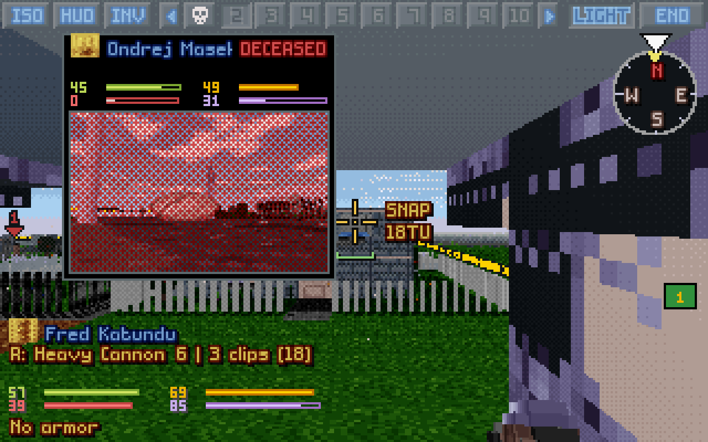
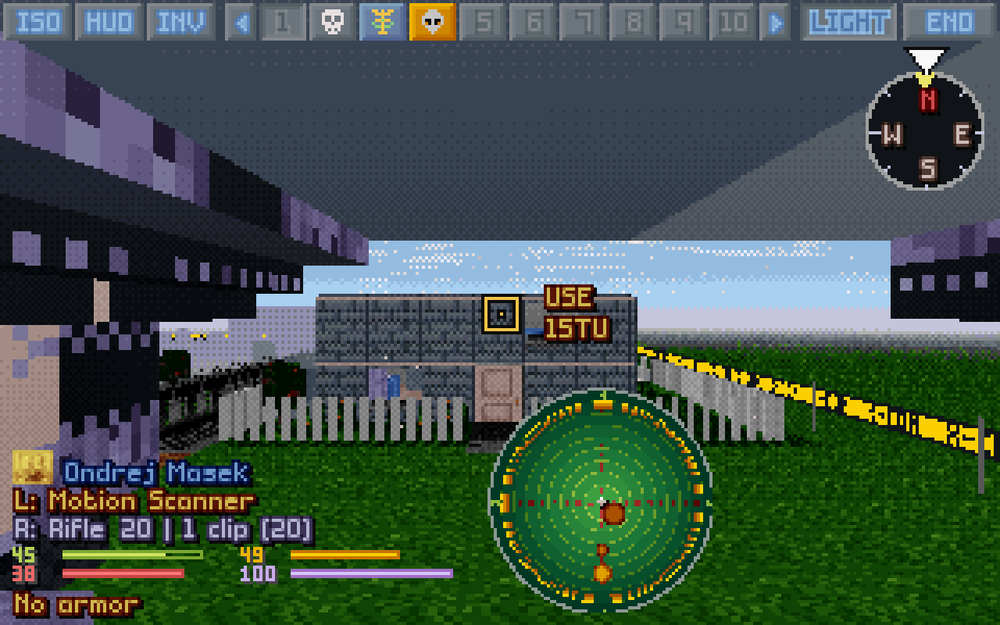
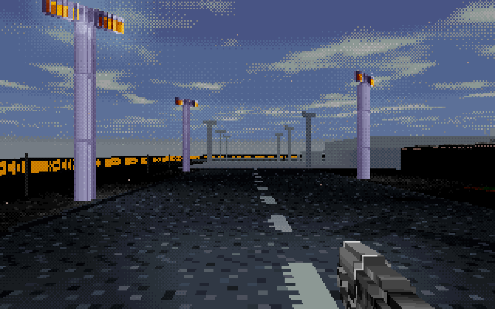
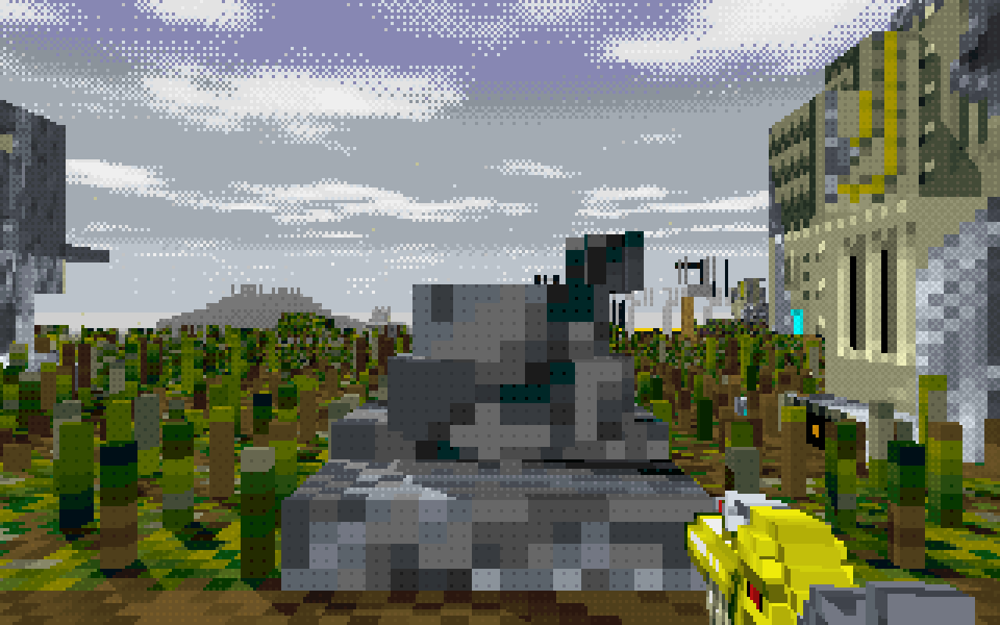

# OpenXcom3D 1.09

*UFO: Enemy Unknown, through a soldier's eyes.*

> **▶ [How to play](https://b0realis.github.io/OpenXcom3D/play.html)** · **[Keys and settings](https://b0realis.github.io/OpenXcom3D/play.html#settings)** · **⚙ [Build from source](https://b0realis.github.io/OpenXcom3D/)**


## New

- **Melee by the crosshair**: a blow strikes what you aim at, diagonals too; floors, ceilings and straight up.
- **The motion scanner in 3D**: held up, turning with the view, a sweep and blips.
- **Full sprite hitboxes** (setting): units are hit, and seen, where their picture shows.
- **Quick deaths** (setting): units drop at once and bursts fire on; your fallen soldier plays on the camera card, the view goes on to the next.
- **A clean view**: P a third time hides the crosshair too.
- **Settings for new players**: the game's own mechanics first, the settings in sections, one Akimbo setting.
- **See-through corpses**, **smoke opacity** by day and night, **Page Up flies**, the snap shot back in FPS style.
- **A logo**, on every build and page.

## Fixed

- Shots nearer the crosshair; no turn when aiming at your own tile.
- The unit pointed at by its hitbox, not a pixel of its picture.
- A UFO's light inside it even, not dotted.
- No walking on out of the map through a door.
- Tails on the floor, not in it; bullet holes grow with the zoom.
- The border tape reads X-COM on every side.

<table>
<tr><td></td><td></td></tr>
<tr><td></td><td></td></tr>
</table>

## Download

Your own *UFO* and/or *TFTD* needed.

- **`OpenXcom3D-1.09-x86_64.AppImage`**: make it executable, run it.
- **`OpenXcom3D-1.09-linux-x86_64.tar.gz`**: unpack, run `./play.sh`.
- **`OpenXcom3D-1.09-windows-x86_64.zip`**: unpack (not in Program Files), run `play.bat`.

SHA256:

```
203db7fa58c0a4a4a950d07957f535265dd41492b253d90839c784cc710f4cd5  OpenXcom3D-1.09-x86_64.AppImage
fb1286c7a0324c970670e861c93ccd1dc58026536a7eac6bf5df3a4e3c6bc7a0  OpenXcom3D-1.09-linux-x86_64.tar.gz
375324a6b0958d2ee25886b8f4467f770ed5c35d9ea7b0d37ba428f0559117f6  OpenXcom3D-1.09-windows-x86_64.zip
```

Thanks to the play-testers, and to the OpenXcom and OpenXcom Extended developers.

**OpenXcom3D team: b0realis, mumble**
