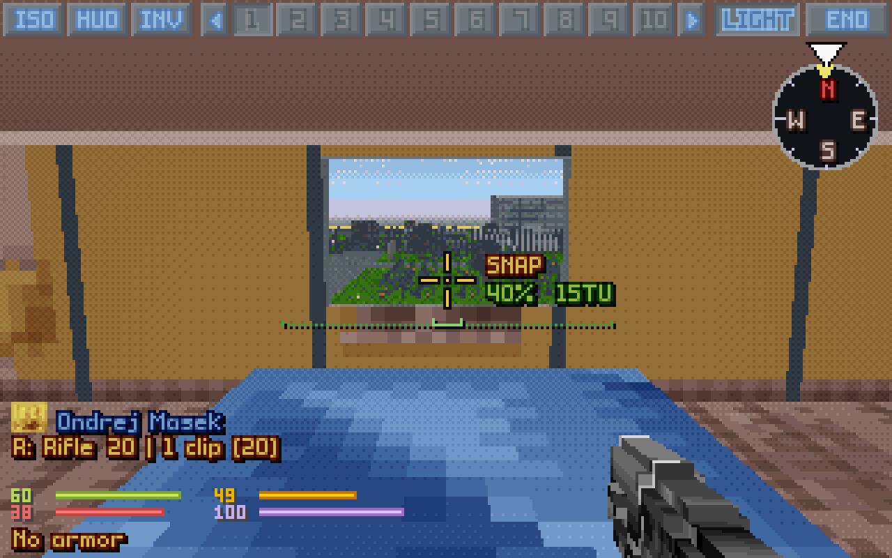
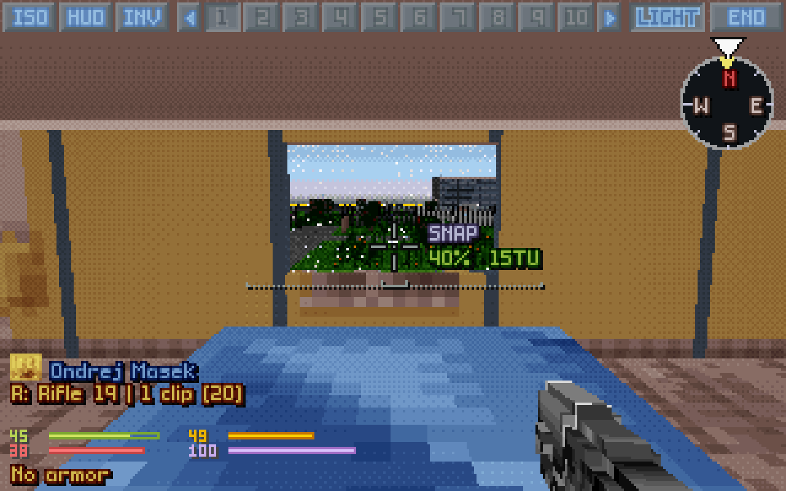
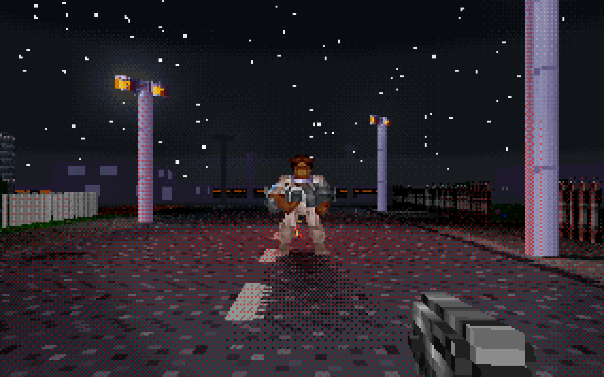
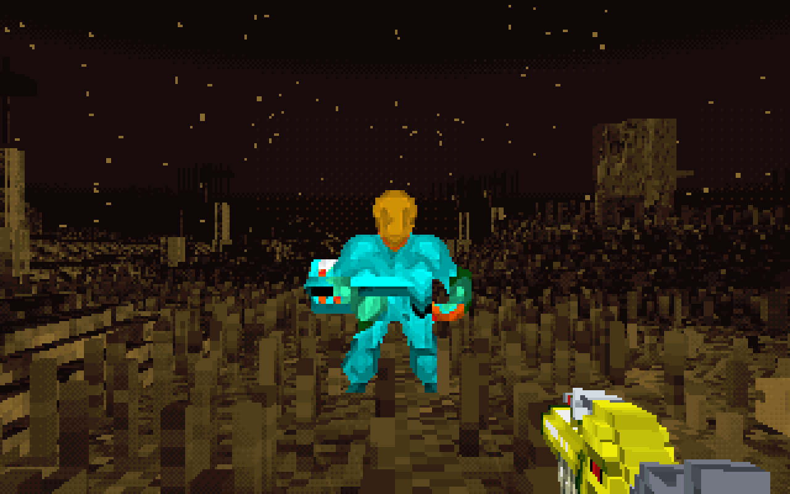

# OpenXcom3D 1.10

*UFO: Enemy Unknown, through a soldier's eyes.*

> **▶ [How to play](https://b0realis.github.io/OpenXcom3D/play.html)** · **[Keys and settings](https://b0realis.github.io/OpenXcom3D/play.html#settings)** · **⚙ [Build from source](https://b0realis.github.io/OpenXcom3D/)**

## New

- **Window glass**: the windows the map sees through are glass, what's behind them a little paler; a plain opening, a barn's window, stays open.
- **Glass shatters**: a round, a pellet, a thrown item or a blast breaks it: shards, a crack and a tinkle, the window open for the rest of the battle.
- **Flare shadows**: a unit lit by a tactical flare throws a long soft shadow.
- **Futuristic night vision** (setting): units and items keep their own colours.
- **Cameras see as the eyes** (setting): helmet cameras see through smoke with heat vision.
- **No harm**: a small blue shield by the crosshair and a dull tick for a strike that did nothing.
- **Hits on downed units** flash, bleed and mark the crosshair.
- **Arcs at the open sky** fly on and come down where they fall.
- **Screen shake** and **Recoil** (settings); the 3D view's own **turn and look keys**; a key waiting to be rebound shows it.
- **Akimbo**: 20% less accurate, not 30%; Y marks it on the map; reaction shots fire both guns.
- **The fire modes** from quantity to quality: auto, snap, aimed.
- A mod's **mana bar** on the 3D panel; the **version** in the main menu.

## Fixed

- X-Com Files' shop windows and glass doors seen through.
- A wall with a small window stays a wall.
- *Auto-equip guns first* hands out the hardest-hitting first, the same every time.
- Zombies hatch the game's way with quick deaths.
- No gun dip when the view goes to another soldier.
- Arcs and throws at a wall you stand against go over it.

<table>
<tr><td></td><td></td></tr>
<tr><td></td><td></td></tr>
</table>

## Download

Your own *UFO* and/or *TFTD* needed.

- **`OpenXcom3D-1.10-x86_64.AppImage`**: make it executable, run it.
- **`OpenXcom3D-1.10-linux-x86_64.tar.gz`**: unpack, run `./play.sh`.
- **`OpenXcom3D-1.10-windows-x86_64.zip`**: unpack (not in Program Files), run `play.bat`.

SHA256:

```
14763588f5955af9a68227130b99b392dfc7f70929abc842c1a6b48bbe50a9b5  OpenXcom3D-1.10-x86_64.AppImage
fda409e6b2af381bebe5ee3af4dff0261bb57974e75bce2cb245928397c702e3  OpenXcom3D-1.10-linux-x86_64.tar.gz
23092377d86a00316f6c455ad5c781443e718619c53dde71fc9dd1b170f56237  OpenXcom3D-1.10-windows-x86_64.zip
```

Thanks to the play-testers and the players who opened issues, and to the OpenXcom and OpenXcom Extended developers.

**OpenXcom3D team: b0realis, mumble**
