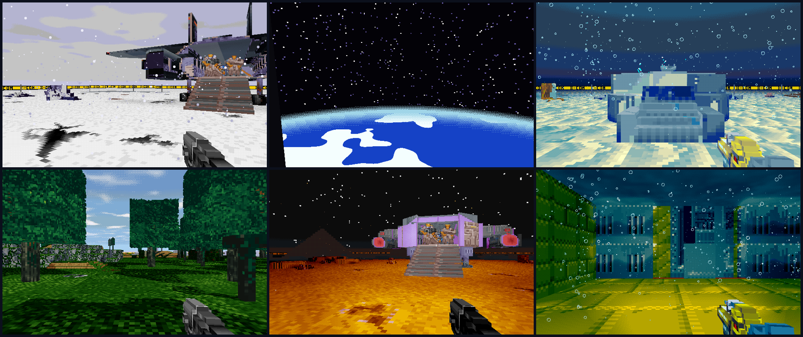
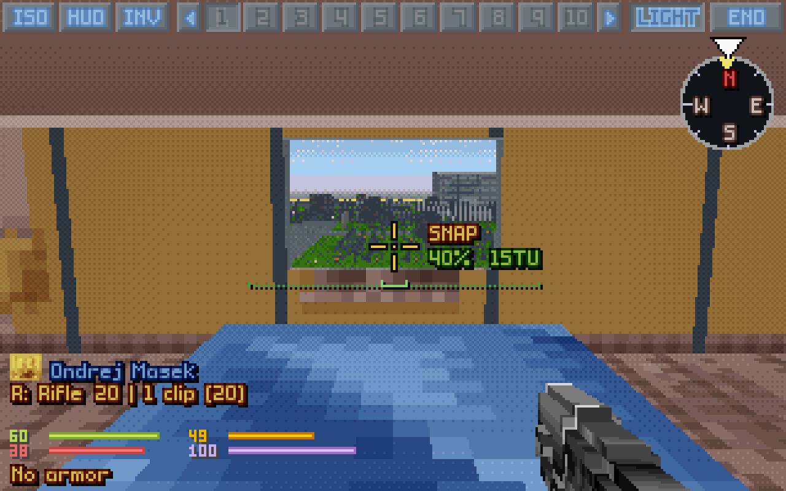
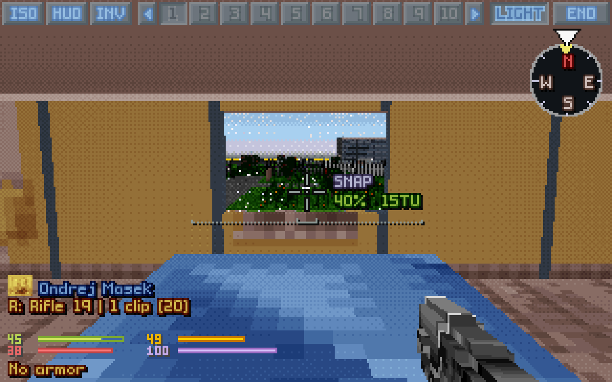
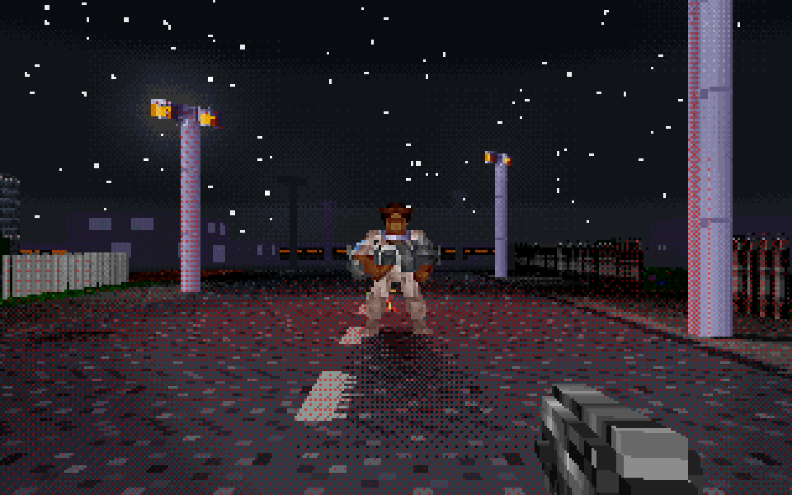
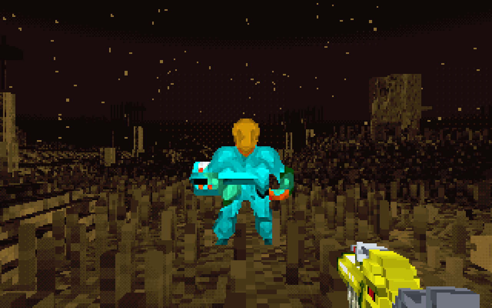

<p align="center"></p>

# OpenXcom3D 1.11

*UFO: Enemy Unknown, through a soldier's eyes. Now under the right sky.*

> **▶ [How to play](https://b0realis.github.io/OpenXcom3D/play.html)** · **[Keys and settings](https://b0realis.github.io/OpenXcom3D/play.html#settings)** · **⚙ [Build from source](https://b0realis.github.io/OpenXcom3D/)**



<p align="center"><i>Snow under cloud · the Earth from orbit · the sea floor · deep woods · Cydonia · T'leth</i></p>

## New

- **Rain and snow under cloud**: a grey deck overhead, no sun, moon or stars.
- **Space and orbit**: black and starry, the Earth below XPiratez's stations, its clouds drifting; the Earth's disc over the Moon.
- **Mars** butterscotch by day, starry by night; the Shadowlands in a violet void.
- **The big mods' seas** run on past the map's edge, as TFTD's does; **19 more maps underground**, under rock.
- **Reload from anywhere**: R takes a clip from anywhere on the soldier, and says why when it can't.
- **A door under the crosshair**: a little green door beside it.
- **Flight kept** through a save and a load.
- **Enemy buttons at the centre right** in 3D, on any screen.
- **Smoke 13–28% cheaper**, drawn the same to the pixel.
- **The logo** in every download, with a sharper icon and, on Windows, one for a shortcut.

## Fixed

- T'leth's ceiling in its own dark green, not black.
- The Bug Hunt line no longer covers the top bar.

## From 1.10

*Window glass, and the players' issues #67 to #91.*

### New

- **Window glass**: the windows the map sees through are glass, what's behind them a little paler; a plain opening, a barn's window, stays open.
- **Glass shatters**: a round, a pellet, a thrown item or a blast breaks it: shards, a crack and a tinkle, the window open for the rest of the battle.
- **Flare shadows**: a unit lit by a tactical flare throws a long soft shadow.
- **Futuristic night vision** (setting): units and items keep their own colours.
- **Cameras see as the eyes** (setting): helmet cameras see through smoke with heat vision.
- **No harm**: a small blue shield by the crosshair and a dull tick for a strike that did nothing.
- **Hits on downed units** flash, bleed and mark the crosshair.
- **Arcs at the open sky** fly on and come down where they fall.
- **Screen shake** and **Recoil** (settings); the 3D view's own **turn and look keys**; a key waiting to be rebound shows it.
- **Akimbo**: 20% less accurate, not 30%; Y marks it on the map; reaction shots fire both guns.
- **The fire modes** from quantity to quality: auto, snap, aimed.
- A mod's **mana bar** on the 3D panel; the **version** in the main menu.

### Fixed

- X-Com Files' shop windows and glass doors seen through.
- A wall with a small window stays a wall.
- *Auto-equip guns first* hands out the hardest-hitting first, the same every time.
- Zombies hatch the game's way with quick deaths.
- No gun dip when the view goes to another soldier.
- Arcs and throws at a wall you stand against go over it.

<table>
<tr><td></td><td></td></tr>
<tr><td></td><td></td></tr>
</table>

## Download

Your own *UFO* and/or *TFTD* needed.

- **`OpenXcom3D-1.11-x86_64.AppImage`**: make it executable, run it.
- **`OpenXcom3D-1.11-linux-x86_64.tar.gz`**: unpack, run `./play.sh`.
- **`OpenXcom3D-1.11-windows-x86_64.zip`**: unpack (not in Program Files), run `play.bat`.

SHA256:

```
06e2b9764cd8a805ef5db4f55e82345ca629c1628da7d22b3aabd8c5497de4aa  OpenXcom3D-1.11-x86_64.AppImage
ae67e0da5c5b286f3b2f03e60cd27b1f33f9f36dd26b2e5290ebd91624cd9d73  OpenXcom3D-1.11-linux-x86_64.tar.gz
4713e73efd06a67865093ae791781d0a3cc7aedfd6e75aea644895e864e1e747  OpenXcom3D-1.11-windows-x86_64.zip
```

Thanks to the play-testers and the players who opened issues, and to the OpenXcom and OpenXcom Extended developers.

**OpenXcom3D team: b0realis, mumble**
