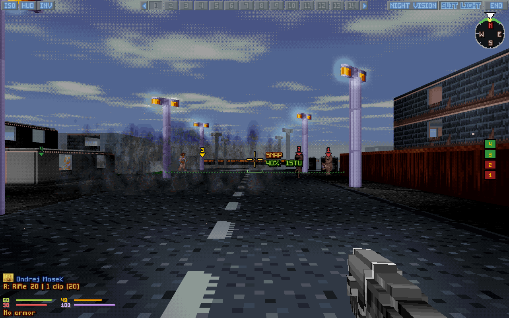

<p align="center"></p>

# OpenXcom3D 1.14

*UFO: Enemy Unknown, through a soldier's eyes. Now drawn by your graphics card, in more than 256 colours if you like.*

*Hot-fixed 2026-11-14.*

> **▶ [How to play](https://b0realis.github.io/OpenXcom3D/play.html)** · **[Keys and settings](https://b0realis.github.io/OpenXcom3D/play.html#settings)** · **⚙ [Build from source](https://b0realis.github.io/OpenXcom3D/)**



<p align="center"><i>Renderer GPU, with everything on: true colour, smooth light, soft shadows, a shadow from every lamp, ambient occlusion, coloured lights, light shafts</i></p>

## New

- **A GPU renderer**, a setting (*Renderer*: GPU): the graphics card casts the 3D world's rays and draws the units and effects, the same picture as the CPU's, checked pixel for pixel. The CPU stays the default and takes over by itself where a card can't.
- **3D resolution**: the 3D world as fine as the HUD, the battlescape or the display itself: 1920×1080 at 60 frames a second and more on a card.
- **HUD scale**: Auto, or x1 to x4.
- **A finer picture on the card**, all settings, all off by default: *Supersampling*, *Soft sun shadows*, *Shadows from every light*, *Ambient occlusion*.
- **True colour** and **Smooth light**: the 3D world past the palette's 256 colours, no dither dots.
- **Coloured lights**: shots, explosions, fires and muzzle flashes light what is round them in their own colour.
- **Reflections**: the sea mirrors the sky and what stands in it.
- **Light shafts**: the flashlight, flares and lamps show as beams in smoke, and everywhere under the sea.
- **Lift beams**: motes and streaks of light rise from a grav lift's floor.
- **Throwing**: Classic (by tile) or Modern (the exact point under the crosshair).
- **Compass: step costs**, and **Alien turn: look as the soldier faces**, both settings.
- **Smooth fire**, a setting: flames blend from frame to frame.
- **Fall damage**, a setting of its own: step off ledges with *Falling* and, if you like, land unhurt.
- **Rangefinder**: Digital (the tiles to what you look at) or Analogue, a scope's scale that grows with the zoom.

## Fixed

- Walking diagonally no longer stutters, and costs a diagonal's time units.
- A bow is held as a bow.
- A mod's flames and campfires no longer flicker between shapes.
- Dark places fade to black through the palette's darker colours.
- A hit on an energy shield shows what the shield lost.
- Walking into a unit you can't see stops as at a wall.
- A shot knocked aside in close quarters no longer throws the wrong soldier's view round.
- A built-in shield shows in the 3D hands.
- Night vision no longer glares in haze.
- Buildings a mod lists among its UFOs are no longer lit as UFOs.
- A see-through corpse keeps its colours under *Futuristic night vision*.
- *Smoke opacity* works for both smoke looks, from 0% (no smoke) to 100% (opaque), and smoke draws faster.
- Tactical flares bounce off glass and land on catwalks; a window's glass shatters.
- A pool's water fills its tiles.
- Someone unconscious in hand shows their name; carried bodies are drawn bigger.

## Download

Your own *UFO* and/or *TFTD* needed.

- **`OpenXcom3D-1.14-x86_64.AppImage`**: make it executable, run it.
- **`OpenXcom3D-1.14-linux-x86_64.tar.gz`**: unpack, run `./play.sh`.
- **`OpenXcom3D-1.14-windows-x86_64.zip`**: unpack (not in Program Files), run `play.bat`.
- **`OpenXcom3D-1.14-macos.zip`** (Apple silicon and Intel, macOS 11 and newer): played on an Apple silicon Mac.

SHA256:

```
69f9874148a38d8892cca3448a317814dfab4725be07fe0f76b4dd72f39abd24  OpenXcom3D-1.14-x86_64.AppImage
f5834bd69435f5979d4dbbbb0d1b4f7912c66e59a1b0319c2fca49d82de80a92  OpenXcom3D-1.14-linux-x86_64.tar.gz
efc4331254b1b0b8deace34ad3c6a08b36cc45d8121f5d602fb85de0e358f108  OpenXcom3D-1.14-windows-x86_64.zip
2c5874d21e2bd22c6216f3ed8b76aa61437a36f560df24ad355fe56d24b58f5b  OpenXcom3D-1.14-macos.zip
```

Thanks to the play-testers and the players who opened issues, and to the OpenXcom and OpenXcom Extended developers.

**OpenXcom3D team: b0realis, mumble**
