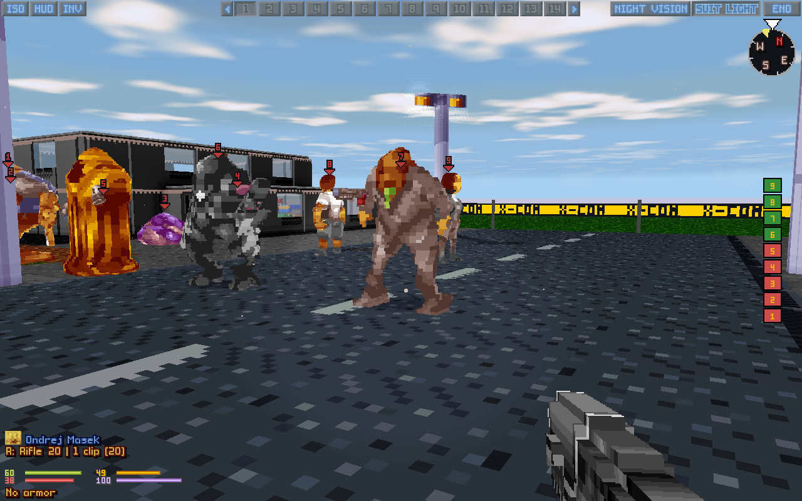
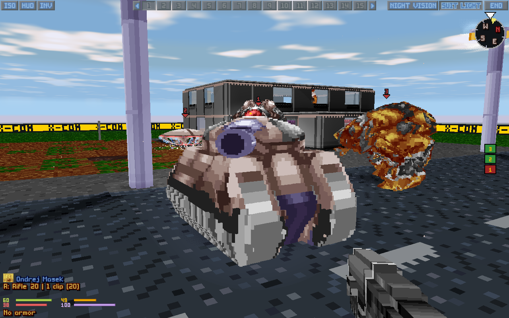

<p align="center"></p>

# OpenXcom3D 1.15

*UFO: Enemy Unknown, through a soldier's eyes. Now the soldiers and the aliens can be 3D too.*

> **▶ [How to play](https://b0realis.github.io/OpenXcom3D/play.html)** · **[Keys and settings](https://b0realis.github.io/OpenXcom3D/play.html#settings)** · **⚙ [Build from source](https://b0realis.github.io/OpenXcom3D/)**



<p align="center"><i>Voxel units (experimental): every unit a 3D body made from its own sprites</i></p>

| | |
|---|---|
|  |  |
| <p align="center"><i>A tank's hollow barrel</i></p> | <p align="center"><i>TFTD: Triscene, Xarquid, Hallucinoid</i></p> |

> **Voxel units are experimental.** Switch them on (first page of the 3D VIEW settings) and tell us what looks wrong: a unit's shape, its colours, its pose, the weapon in its hands. [Open an issue](https://github.com/b0realis/OpenXcom3D/issues) with a screenshot and, if you can, the save.

## New

- **Voxel units (experimental)**, off by default; the switch is on the first page of the 3D VIEW settings: soldiers, aliens, civilians and tanks are 3D bodies of small cubes made from their own sprites, in both games and in mods. They turn smoothly, walk, kneel, fall and lie where they fell; what you see is what a shot hits. On the CPU and the GPU renderer.
- **The 3D VIEW settings, redesigned**: a first page of eight rows, Controls, and Advanced with every setting under its section. **Gameplay** is one of six presets (FAITHFUL, Extended+, TACTICUS, XMbl, FullQoL, FPS), **Graphics detail** Low, Medium or High; **Recommended game options** sets OpenXcom's own options on a click.
- **Tactical map**: the map opened from the 3D view fills the screen, with your soldiers' numbers, the enemies' classes and a view cone on every dot.
- **Surface relief** (GPU, off by default): walls, floors and hulls catch the light by what is drawn on them. It costs some performance.
- **Reflections** on window glass and on still water (swamps, ponds), not only the sea.
- **Flashlight**: Beam, or the new Far light, a light where you aim, as bright at any range. The flashlight, the flares, zoom and night vision are always there now: their on/off settings are gone.
- **Zoom up to 8 times**: hold Jump while zoomed.
- **Emergency climb**, a key (none at first): on some maps a unit can get stuck, in a pit or a fenced yard with no way out. The key gets it out of a pit, up a ledge or over a fence; it costs half the unit's time units, up to all with a full load.
- **A right click opens the door you point at**, as on the map (a setting).
- **Facing icons**: with *Show facing* held, an arrow on each unit as well as the ring round its feet (a setting).
- **V** switches between the map and the 3D view, beside F8.
- **A big hull's picture lies back**: tanks, hover tanks and Cyberdiscs no longer stand on end when seen from above (without voxel units).
- **IDCLIP for big units** in Doom mode.

## Fixed

- **GPU renderer: no freeze on your first look in 3D.** The graphics card has to load its shaders, which takes a while only the first time (a moment after that). This now happens before the battle, while it loads, under a **PREPARING 3D...** notice, instead of freezing the game on the first click on the 3D button; the *Renderer* setting warns about it too.
- Fire in great amounts no longer drags the frame rate down; fires burn as far as the view reaches.
- Every animated tile part moves in 3D, and none stands in dots while it does.
- What lies in the floor shows: rubble, tufts, ponds, stumps.
- A unit killed in the air plummets and stays down.
- A unit's head stays under the floor above it; a unit under a low roof is drawn whole.
- A melee blow at a wall no longer turns the soldier away from it.
- A spray burst from two guns is two bursts; a burst fired from the air is a whole burst.
- Swamp water has no pits; water lying flat fills its tile; a house's floor is no glass.
- Smoke through night vision has no neon rings, and night vision on the GPU has no dark band along the horizon.
- Shot marks are as big in the world from any distance.
- The stars stay points when you look up.
- A struck-down door is gone, texture and all.
- Long weapons whose inventory picture carries a slot frame (the 40k mod's) are drawn clean in the hands.
- A weapon's underside can be named in the rules (The X-Com Files' P90 was upside down in the hands).

## Download

Your own *UFO* and/or *TFTD* needed.

- **`OpenXcom3D-1.15-x86_64.AppImage`**: make it executable, run it.
- **`OpenXcom3D-1.15-linux-x86_64.tar.gz`**: unpack, run `./play.sh`.
- **`OpenXcom3D-1.15-windows-x86_64.zip`**: unpack (not in Program Files), run `play.bat`.
- **`OpenXcom3D-1.15-macos.zip`** (Apple silicon and Intel, macOS 11 and newer).

SHA256:

```
6cfdd3cc66528551b7ceb313f48a5e84a7a85dd8e7341cf5213abea9f2b30a53  OpenXcom3D-1.15-x86_64.AppImage
1a570be8166af8425e2a469bc983170a038a752d7cfe4be030f2b3b2718f7dd3  OpenXcom3D-1.15-linux-x86_64.tar.gz
a8ae175c082b354601fac26baf418f6515fd39fc9700ddb0dc5f6c1cf21dd55f  OpenXcom3D-1.15-windows-x86_64.zip
2142cbcba75d50963b63282e5faa2cf6713ba626e424f523aa59c3548e8f078b  OpenXcom3D-1.15-macos.zip
```

Thank you to the wonderful community: the play-testers, everyone who opened an issue, and the OpenXcom and OpenXcom Extended developers. We hope you enjoy the mod as much as we do :)


<p align="center"><i>Aaaaaa :)</i></p>

**OpenXcom3D team: b0realis, mumble**
