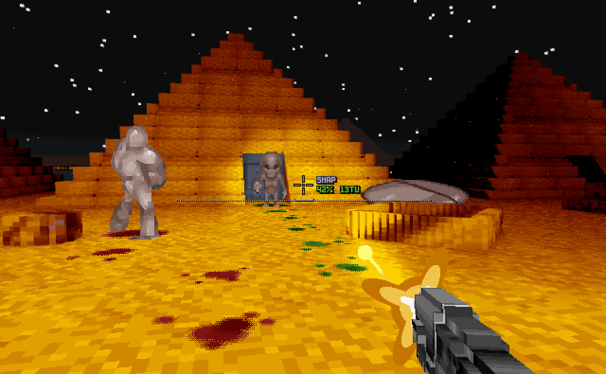

<p align="center"></p>

# OpenXcom3D 1.16

*A bug-fix and robustness release.*

> **▶ [How to play](https://b0realis.github.io/OpenXcom3D/play.html)** · **[Keys and settings](https://b0realis.github.io/OpenXcom3D/play.html#settings)** · **⚙ [Build from source](https://b0realis.github.io/OpenXcom3D/)**



<p align="center"><i>Blood trails: the wounded bleed where they walk and stand</i></p>

## Fixed

- Units walk diagonally in 3D, as on the map.
- No falling into solid rock; thin walls are not ground.
- Obliteration in UFO and TFTD only with the mod on.
- Blood only on explored floors.
- Recommended game options: Apply while one isn't set.
- No crash quitting early (GPU).
- Trees without pillars; no floor edge under outer walls; lifts only where units float.
- Window glass mirrors without Smooth light; Steam Deck mirrors stay on.
- Voxel units: tails, XPiratez's tank, backs and waists.
- OK keeps the window.

## Robustness

- Four independent code reviews of every change since 1.15.
- Full test suite: smoothness, ~1,150 game steps, memory and thread checks.
- The memory-checked build builds again.

## New

- Settings: *Blood trails*, *Obliteration*, overkill damage numbers, *Liquid screens*.

## Download

Your own *UFO* and/or *TFTD* needed.

- **`OpenXcom3D-1.16-x86_64.AppImage`**: make it executable, run it.
- **`OpenXcom3D-1.16-linux-x86_64.tar.gz`**: unpack, run `./play.sh`.
- **`OpenXcom3D-1.16-windows-x86_64.zip`**: unpack (not in Program Files), run `play.bat`.
- **`OpenXcom3D-1.16-macos.zip`** (Apple silicon and Intel, macOS 11 and newer).

SHA256:

```
5735205eac49f294055aeed4d30ecb1c03dc3068aad71845ca2d6016ebcea788  OpenXcom3D-1.16-x86_64.AppImage
fe2b38e04209aeb4ca137ed6356607e9d8f4a7d9ccbdcf933df131ceed6dc0ec  OpenXcom3D-1.16-linux-x86_64.tar.gz
16c6d4f0c55c40f53af28852dc65fa33c80265bb4445fe0e488f2167f2018098  OpenXcom3D-1.16-windows-x86_64.zip
899b79c706dec014e6f6855f6d68fad23b765b5c09251139ea89e3483c555c4e  OpenXcom3D-1.16-macos.zip
```

Thank you to the wonderful community for every report. Enjoy the mod as much as we do :)

**OpenXcom3D team: b0realis, mumble**
